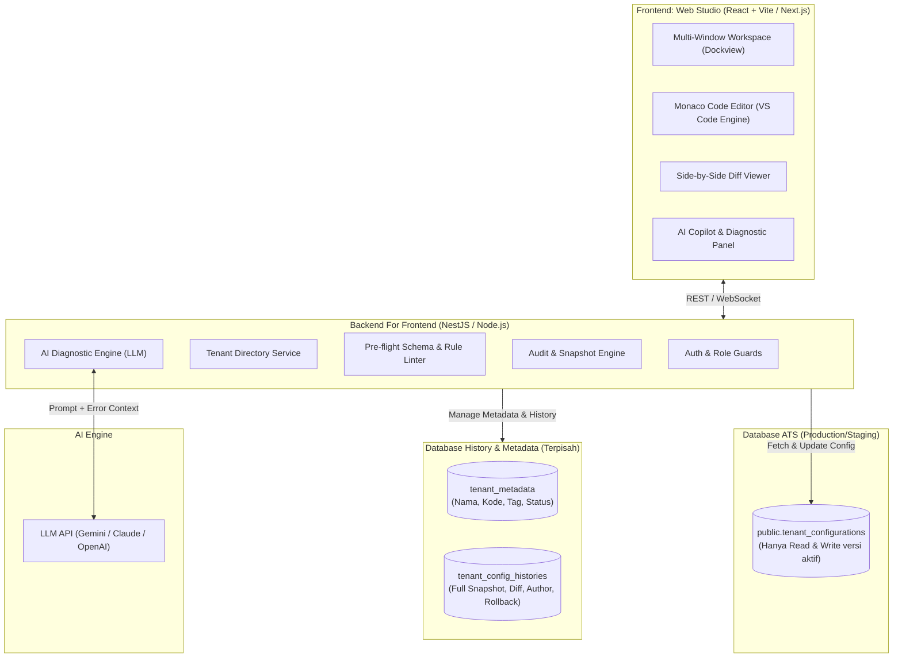

# Tenant Configuration Studio (Beta)
> **Platform Manajemen, Validasi, Audit Trail, dan AI Diagnostics untuk `tenant_configurations`**

---

## 1. Latar Belakang & Masalah (Problem Statement)
Saat ini pengelolaan konfigurasi tenant (khususnya konfigurasi dinamis seperti `CANDIDATE_STABLE` pada ATS):
1. **Harus Akses Database Langsung:** Mengubah JSONB mentah secara manual di database rawan kesalahan sintaks, tipe data tidak sinkron, dan human-error yang berakibat *production downtime*.
2. **Tidak Ada Audit Trail & History:** Tidak ada riwayat perubahan (siapa yang mengubah, kapan, apa diff perubahannya, dan tidak bisa rollback dengan 1 klik).
3. **Identitas Tenant Tidak Manusiawi:** Tenant hanya dikenali lewat UUID acak (contoh: `019fa680-855c-7de7-8707-0831d5761922`), menyulitkan pencarian konfigurasi milik klien tertentu (misal: Indomaret).
4. **Error Runtime Sulit Didiagnosa:** Kesalahan seperti `resolvePaths` pada file view yang memicu `500 invalid input syntax for type uuid` atau ketidakcocokan tipe JSONB vs text tidak terdeteksi sebelum disimpan.
5. **Keterbatasan Workspace:** Tidak ada fitur untuk membuka beberapa konfigurasi tenant sekaligus untuk membandingkan atau menyalin field secara berdampingan (*side-by-side*).

---

## 2. Tujuan Aplikasi (Goals)
1. **Pusat Manajemen Berbasis Web (Internal Web Studio):** Tanpa perlu install aplikasi desktop, cukup via browser dengan kemampuan *multi-window* (tiling panel gaya VS Code).
2. **Pemisahan Database History:** Riwayat versi dan metadata disimpan di database terpisah agar tidak membebani database utama ATS (`ats_db`).
3. **Tenant Directory & Labeling:** Memberikan nama, logo, tag, dan environment pada setiap `tenant_id`.
4. **Pre-flight Linting & Validator:** Pengecekan otomatis sebelum data disimpan ke database utama (JMESPath validator, deteksi UUID file view, validasi schema DTO).
5. **AI Assistant Terintegrasi:** Menganalisa log/error response langsung dari ATS dan memberikan solusi/perbaikan otomatis (*one-click fix*).
6. **Perbandingan & Rollback:** Diff viewer visual (merah/hijau) antar versi serta fitur pengembalian versi (*rollback*).

---

## 3. Arsitektur Sistem



---

## 4. Skema Database History & Metadata (Database Terpisah)

```sql
-- 1. Metadata Label Tenant
CREATE TABLE tenant_metadata (
    tenant_id VARCHAR(64) PRIMARY KEY,      -- Contoh: 019fa680-855c-7de7-8707-0831d5761922
    client_name VARCHAR(255) NOT NULL,      -- Contoh: "Indomaret"
    client_code VARCHAR(50),                -- Contoh: "IDM"
    environment VARCHAR(50) DEFAULT 'production', -- staging / production
    tags TEXT[] DEFAULT '{}',               -- Contoh: ARRAY['retail', 'stable-v2']
    contact_person VARCHAR(255),
    notes TEXT,
    created_at TIMESTAMP WITH TIME ZONE DEFAULT NOW(),
    updated_at TIMESTAMP WITH TIME ZONE DEFAULT NOW()
);

-- 2. Audit Trail & History Perubahan Konfigurasi
CREATE TABLE tenant_config_histories (
    id UUID PRIMARY KEY DEFAULT gen_random_uuid(),
    tenant_id VARCHAR(64) NOT NULL,
    config_type VARCHAR(100) NOT NULL,      -- Contoh: "CANDIDATE_STABLE"
    core_config_id VARCHAR(64),             -- ID baris di public.tenant_configurations
    version INT NOT NULL,                   -- Versi increment: 1, 2, 3...
    config_value JSONB NOT NULL,            -- Full snapshot JSON lengkap saat itu
    diff_patch JSONB,                       -- RFC 6902 JSON Diff patch
    change_summary VARCHAR(500),            -- Catatan user: "Hapus resolvePaths pada file views"
    author_id VARCHAR(64) NOT NULL,
    author_name VARCHAR(100) NOT NULL,
    is_rollback BOOLEAN DEFAULT FALSE,
    rolled_back_from_version INT,
    created_at TIMESTAMP WITH TIME ZONE DEFAULT NOW()
);

CREATE INDEX idx_histories_tenant_config ON tenant_config_histories (tenant_id, config_type, version DESC);
```

---

## 5. Rincian Fitur Aplikasi

### Modul 1: Tenant Directory & Discovery
- **Tabel List Tenant:** Menampilkan daftar semua tenant lengkap dengan nama klien, logo/inisial, environment, dan tanggal update terakhir.
- **Pencarian Cepat & Filter:** Cari berdasarkan nama perusahaan (misal *"Indomaret"*), atau paste UUID langsung.
- **Label Editor:** Tambah/ubah nama klien, tag, atau deskripsi tanpa mengubah data ATS utama.

### Modul 2: Multi-Window Workspace (Docking System)
- **Gaya VS Code (Dockview):** 
  - Bisa split panel horizontal & vertical (kiri-kanan, atas-bawah).
  - Bisa membuka **Tenant A** di panel 1, **Tenant B** di panel 2 untuk referensi *copy-paste*.
  - Tab bisa di-*drag-and-drop* atau ditutup per panel.
- **Detachable Pop-out Window:**
  - Tombol *"Open in new window"* untuk pengguna dengan multi-monitor.
  - Sinkronisasi state antar window menggunakan `BroadcastChannel API`.

### Modul 3: Monaco Editor & Pre-flight Validator
- **Monaco Code Editor:** Sintaks highlighting JSON, code folding, minimap, formatting instan (`Prettier`).
- **Pre-flight Linter (Guardrail):**
  - **Syntax Validation:** Mencegah syntax error JSON.
  - **JMESPath Validator:** Memvalidasi ekspresi JMESPath pada rules dan options view.
  - **File View Guard:** Peringatan otomatis jika `type: "isFile"` memiliki `resolvePaths` (mencegah error 500 UUID).
  - **Data Type Consistency:** Memvalidasi field `customFields` dengan spesifikasi DTO backend.

### Modul 4: Version History, Visual Diff & Rollback
- **Git-Style Diff Viewer:** Membandingkan versi baru dengan versi aktif di production dengan highlight baris merah/hijau.
- **Commit Message Prompt:** Setiap user menekan *"Save"*, wajib mengisi ringkasan perubahan (misal: *"Menambahkan 5 custom field identitas"*).
- **One-Click Rollback:** Tombol untuk mengembalikan konfigurasi production ke versi sebelumnya secara instan jika terjadi insiden.

### Modul 5: AI Diagnostics & Copilot
- **Error Inspector:** Input box untuk mem-paste error response ATS (misal error HTTP 400 atau 500).
- **Analisis Konteks Otomatis:** Sistem mengirimkan konteks JSON config + pesan error ke LLM.
- **Root Cause & Auto-Fix:**
  - Menjelaskan baris dan penyebab error secara spesifik.
  - Tombol *"Apply Suggestion"* untuk langsung memperbaiki JSON di editor secara otomatis.

---

## 6. Rencana Struktur Folder Project (`app_tenant_config_beta`)

```plaintext
app_tenant_config_beta/
├── README.md                      # Dokumentasi & panduan umum
├── ARCHITECTURE.md                # Spesifikasi detail arsitektur & flow
├── docker-compose.yml             # Local audit database (PostgreSQL) + services
│
├── apps/
│   ├── web/                       # Frontend Application
│   │   ├── package.json
│   │   ├── vite.config.ts / next.config.js
│   │   ├── src/
│   │   │   ├── components/
│   │   │   │   ├── workspace/     # Multi-window Dockview layout
│   │   │   │   ├── editor/        # Monaco JSON Editor & Diff Viewer
│   │   │   │   ├── ai/            # AI Diagnostic panel & chat
│   │   │   │   ├── tenant/        # Tenant directory & label management
│   │   │   │   └── history/       # Version list & rollback dialog
│   │   │   ├── hooks/             # BroadcastChannel, State sync
│   │   │   ├── services/          # API Client ke BFF
│   │   │   └── App.tsx
│   │   └── ...
│   │
│   └── bff/                       # Backend For Frontend Service
│       ├── package.json
│       ├── src/
│       │   ├── modules/
│       │   │   ├── tenant/        # Proxy & metadata management
│       │   │   ├── config/        # Fetch & save ke core ATS DB
│       │   │   ├── audit/         # History & snapshot di Audit DB
│       │   │   ├── validator/     # JMESPath & Schema linter engine
│       │   │   └── ai/            # AI prompt & diagnostics provider
│       │   ├── database/          # TypeORM / Prisma / Drizzle connections
│       │   └── main.ts
│       └── ...
│
└── config/
    └── .env.example               # Template environment variables
```

---

## 7. Rencana Tahapan Pengerjaan (Implementation Roadmap)

| Tahap | Fokus Utama | Deliverables |
| :--- | :--- | :--- |
| **Fase 1** | Setup Pondasi & Skema DB | - Struktur folder monorepo/workspace.<br>- Setup DB history (docker-compose / schema SQL).<br>- Endpoint CRUD Tenant Metadata & Fetch Active Config. |
| **Fase 2** | Editor & Multi-Window UI | - UI React + Dockview (tiling multi-window).<br>- Integrasi Monaco JSON Editor.<br>- Integrasi Tenant Directory (pencarian nama klien). |
| **Fase 3** | Pre-flight Linter & History Engine | - Validator otomatis (JMESPath, File UUID guard).<br>- Mekanisme snapshot history saat save.<br>- Visual Diff Viewer & One-Click Rollback. |
| **Fase 4** | AI Diagnostic Assistant | - Panel AI troubleshooting di frontend.<br>- Backend connector ke LLM API dengan system prompt khusus aturan ATS. |
| **Fase 5** | Hardening & Polish | - PWA configuration (bisa di-install sebagai desktop-like web app).<br>- Role guard & security check. |

---

## 8. Template Environment Variables (`.env.example`)
Variabel yang nantinya akan diisi:
```env
# Port & Host
PORT_BFF=4000
PORT_WEB=3000

# Core ATS Database (Read & Write Konfigurasi Aktif)
CORE_ATS_DB_HOST=172.16.167.0
CORE_ATS_DB_PORT=30543
CORE_ATS_DB_USER=
CORE_ATS_DB_PASSWORD=
CORE_ATS_DB_NAME=ats_db

# Audit & History Database (Database Terpisah)
AUDIT_DB_HOST=
AUDIT_DB_PORT=5432
AUDIT_DB_USER=
AUDIT_DB_PASSWORD=
AUDIT_DB_NAME=tenant_config_audit_db

# AI Provider Credentials
AI_PROVIDER=gemini # atau openai / anthropic
AI_API_KEY=
```

---

## 8. Panduan Konteks AI & Arsitektur Lengkap (Handbook)

Untuk asisten AI coding (seperti Antigravity, Gemini CLI, Claude Code) atau insinyur baru yang ingin memahami arsitektur, skema JSON, guardrail validasi, dan alur database secara menyeluruh, silakan rujuk:
- 📖 [**AI Project Context Handbook (`docs/AI_PROJECT_CONTEXT_HANDBOOK.md`)**](file:///Users/ketutkusuma/J/app_tenant_config_beta/docs/AI_PROJECT_CONTEXT_HANDBOOK.md): Panduan komprehensif 1800+ baris mencakup filosofi multi-tenant, tabel database, BFF REST API, Monaco editor, dan RFC 6902 delta diff.
- 🤖 [**Master AI Skill (`docs/skills/tenant-configuration/SKILL.md`)**](file:///Users/ketutkusuma/J/app_tenant_config_beta/docs/skills/tenant-configuration/SKILL.md): Spesifikasi resmi Antigravity Skill System.
- 📋 [**Checklist Kasus Uji (`docs/TEST_CASES_CHECKLIST.md`)**](file:///Users/ketutkusuma/J/app_tenant_config_beta/docs/TEST_CASES_CHECKLIST.md): 15 skenario pengujian fungsional dan regresi.

## 9. MCP Server untuk Agent AI Lokal

`apps/mcp` menyediakan MCP server **hanya-baca** agar agent AI lokal (Claude Code, dll.) bisa membaca,
membandingkan, memvalidasi, dan menyusun usulan perubahan konfigurasi lewat BFF. Agent tidak bisa
menyimpan ke database; usulan diterapkan user lewat Studio. Cara pakai: [`apps/mcp/README.md`](apps/mcp/README.md).

