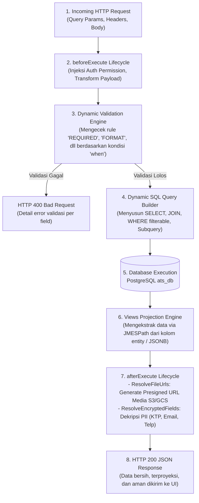

# Panduan Lengkap & Spesifikasi Teknis: Tenant Configuration (`tenant_configurations`)

> **Dokumentasi Resmi Arsitektur, Cara Kerja, Fitur-Fitur Kustom, dan Penggunaan Tenant Configuration Studio**  
> *Versi: 2.0.0 — Dibuat untuk ATS Platform & Tenant Studio*

---

## DAFTAR ISI
1. [Pengenalan & Konsep Dasar `tenant_configurations`](#1-pengenalan--konsep-dasar-tenant_configurations)
2. [Arsitektur & Siklus Eksekusi (How It Works)](#2-arsitektur--siklus-eksekusi-how-it-works)
3. [Struktur Root Dokumen JSON Konfigurasi](#3-struktur-root-dokumen-json-konfigurasi)
4. [Bedah Fitur 1: `views` (Data Projection Engine)](#4-bedah-fitur-1-views-data-projection-engine)
   - [Properti Utama `views`](#properti-utama-views)
   - [Memahami `resolvePaths` & Pencegahan Error 500 UUID](#memahami-resolvepaths--pencegahan-error-500-uuid)
   - [Penggunaan SQL `join` Dinamis](#penggunaan-sql-join-dinamis)
   - [Penggunaan SQL `subQuery` & `isSubQuery`](#penggunaan-sql-subquery--issubquery)
5. [Bedah Fitur 2: `filterable` (Dynamic Filtering Engine)](#5-bedah-fitur-2-filterable-dynamic-filtering-engine)
6. [Bedah Fitur 3: `validation` (Dynamic Rule Validation Engine)](#6-bedah-fitur-3-validation-dynamic-rule-validation-engine)
7. [Bedah Fitur 4: Keamanan Data & Dekripsi (`decryptable` & `ResolveEncryptedFields`)](#7-bedah-fitur-4-keamanan-data--dekripsi-decryptable--resolveencryptedfields)
8. [Bedah Fitur 5: Interceptor Pipeline (`beforeExecute` & `afterExecute`)](#8-bedah-fitur-5-interceptor-pipeline-beforeexecute--afterexecute)
9. [Bedah Fitur 6: `customData` & `moduleReferences`](#9-bedah-fitur-6-customdata--modulereferences)
10. [Bedah Fitur 7: `searchable`, `rules`, dan Fitur Kecil Lainnya](#10-bedah-fitur-7-searchable-rules-dan-fitur-kecil-lainnya)
11. [Cara Mengelola Konfigurasi dengan Tenant Configuration Studio](#11-cara-mengelola-konfigurasi-dengan-tenant-configuration-studio)
    - [Pemisahan 2 Window: Database Live vs Preset Lokal](#pemisahan-2-window-database-live-vs-preset-lokal)
    - [Guardrail Pre-flight Validator](#guardrail-pre-flight-validator)
    - [Sync Center: Komparasi Kanonikal, Push, dan Pull](#sync-center-komparasi-kanonikal-push-dan-pull)
    - [Audit Trail & Snapshot Versioning di Neon DB](#audit-trail--snapshot-versioning-di-neon-db)
12. [Studi Kasus & Contoh Konfigurasi Utuh](#12-studi-kasus--contoh-konfigurasi-utuh)
13. [Panduan Troubleshooting & FAQ Error Umum](#13-panduan-troubleshooting--faq-error-umum)

---

## 1. Pengenalan & Konsep Dasar `tenant_configurations`

### Apa itu `tenant_configurations`?
Dalam sistem Applicant Tracking System (ATS), setiap perusahaan (klien/tenant) memiliki kebutuhan rekrutmen yang berbeda-beda:
- Format profil kandidat yang berbeda (misal: satu tenant butuh KTP & Pas Foto, tenant lain butuh sertifikat lisensi atau NPWP).
- Aturan validasi yang dinamis (misal: gaji wajib diisi di perusahaan A, tetapi opsional di perusahaan B).
- Filter data yang disesuaikan dengan alur bisnis masing-masing.

Alih-alih membuat tabel database fisik baru atau menjalankan migrasi DDL (`ALTER TABLE`) setiap kali ada klien baru, sistem menggunakan pendekatan **Dynamic Metadata-Driven Architecture**. Seluruh definisi tampilan, filter, validasi, dan integrasi modul disimpan dalam bentuk dokumen **JSONB** di tabel:
```sql
public.tenant_configurations
```

### Tabel Database Utama (`ats_db`)
Struktur tabel fisik di PostgreSQL:
- `id` (`UUID`): Primary key baris konfigurasi.
- `tenant_id` (`UUID`, nullable): ID tenant pemilik konfigurasi. Jika bernilai `NULL`, konfigurasi ini berlaku sebagai **Global Default / Fallback** untuk seluruh tenant.
- `group_id` (`UUID`, nullable): ID grup organisasi jika tenant berada dalam satu grup holding.
- `config_type` (`VARCHAR`): Jenis domain konfigurasi, contohnya:
  - `CANDIDATE_STABLE`: Konfigurasi profil, custom fields, dan views data kandidat.
  - `VACANCY_STABLE`: Konfigurasi lowongan kerja, headcount, dan kriteria posisi.
  - `APPLICANT_STABLE`: Konfigurasi pipeline lamaran dan status proses rekrutmen.
- `path` (`VARCHAR`, nullable): Path identifikasi URL atau alias modul.
- `value` (`JSONB`): Dokumen JSON yang mengatur logika aplikasi secara dinamis.
- `is_default` (`BOOLEAN`): Penanda apakah baris ini adalah template default.
- `created_at` & `updated_at`: Metadata timestamp.

---

## 2. Arsitektur & Siklus Eksekusi (How It Works)

Ketika frontend ATS atau API client memanggil endpoint (misalnya `GET /api/v1/candidates` atau `POST /api/v1/vacancies`), backend ATS membaca dokumen `tenant_configurations` untuk tenant tersebut dan mengeksekusi pipeline berikut:



---

## 3. Struktur Root Dokumen JSON Konfigurasi

Sebuah dokumen `tenant_configurations.value` memiliki struktur root standar sebagai berikut:

```json
{
  "url": {
    "directVacancyDetailPath": "/search-jobs/:id"
  },
  "views": [ ... ],
  "filterable": [ ... ],
  "searchable": [ ... ],
  "validation": [ ... ],
  "decryptable": [ ... ],
  "customData": { ... },
  "moduleReferences": [ ... ],
  "beforeExecute": [ ... ],
  "afterExecute": [ ... ],
  "maxBatchProcess": 100
}
```

---

## 4. Bedah Fitur 1: `views` (Data Projection Engine)

Array `views` adalah jantung dari serialisasi data. Array ini mendikte bagaimana kolom database PostgreSQL dipetakan menjadi objek JSON yang dikirimkan ke frontend.

### Properti Utama `views`
Setiap elemen di dalam array `views` mendukung properti berikut:

| Properti | Tipe | Deskripsi & Contoh |
| :--- | :--- | :--- |
| `view` | `string` | **Nama alias field output** yang diterima frontend. Contoh: `"candidateName"`, `"resumeUrl"`. |
| `label` | `string` | Label deskriptif untuk antarmuka pengguna (UI). Contoh: `"Nama Lengkap"`, `"Berkas CV"`. |
| `column` | `string` | Kolom sumber di tabel PostgreSQL. Bisa kolom fisik biasa (`"name"`), kolom JSONB (`"customFields"`), atau ekspresi JSON arrow (`"v.city_meta ->> 'name'"`). |
| `path` | `string` | **JMESPath Expression** yang mengekstrak nilai spesifik dari data kolom. Contoh: `"$name"`, `"$candidateMetas[0].data.name"`, atau proyeksi objek `"$pics[].{id: id, name: employeeMeta.name}"`. |
| `isFile` | `boolean` | `true` jika field ini merupakan file/media digital (foto, PDF, dokumen). |
| `isEncrypted` | `boolean` | `true` jika nilai di database tersimpan dalam bentuk terenkripsi. |
| `isMediaId` | `boolean` | `true` jika nilai field adalah UUID referensi ke microservice media. |
| `resolvePaths` | `string[]`| Daftar path JSON internal yang harus diselesaikan oleh resolver (lihat penjelasan di bawah). |
| `join` | `object[]` | Array konfigurasi SQL JOIN jika field membutuhkan data dari tabel lain. |
| `subQuery` | `string` | SQL Subquery langsung untuk kalkulasi agregat. |
| `isSubQuery` | `boolean` | `true` jika field ini dieksekusi sebagai subquery. |

---

### Memahami `resolvePaths` & Pencegahan Error 500 UUID

#### Apa itu `resolvePaths`?
Di backend ATS, file media dan data terenkripsi tidak disimpan sebagai URL publik langsung. Yang disimpan di PostgreSQL adalah metadata berkas (seperti `fileKey`, `mimeType`, atau `mediaId`).

Ketika microservice `afterExecute` (khususnya `ResolveFileUrls`) berjalan, service tersebut membutuhkan instruksi mengenai **path mana saja di dalam struktur JSON** yang harus dicari dan diubah menjadi URL unduhan sementara (S3/GCS Presigned Signed URL).

Contoh penggunaan `resolvePaths` yang benar pada objek bersarang (*nested object*):
```json
{
  "path": "$customFields[?fieldKey=='ktpId'].meta | [0].{fileKey: fileKey, fileUrl: url, mimeType: mime, isFullUrl: isFullUrl}",
  "view": "ktp",
  "label": "KTP",
  "column": "customFields",
  "isFile": true,
  "resolvePaths": [
    "$customFields[?fieldKey=='ktpId'].meta.fileKey",
    "$customFields[?fieldKey=='ktpId'].meta.url",
    "$customFields[?fieldKey=='ktpId'].meta.mime",
    "$customFields[?fieldKey=='ktpId'].meta.isFullUrl"
  ]
}
```

#### Kasus Error Kritis: Mengapa `resolvePaths` Tidak Boleh Sembarangan Dipasang?
> **PERINGATAN SANGAT PENTING (Runtime Guardrail):**  
> Pada entity yang kolomnya mengembalikan **UUID string mentah** atau objek media langsung (contoh: `candidate.profilePhotoMedia` atau `v.resume_file_id`), memasang `resolvePaths` yang menunjuk ke dirinya sendiri akan menyebabkan resolver ATS memperlakukan string UUID sebagai path lookup media.  
> Akibatnya, PostgreSQL/Node backend akan gagal mem-parse tipe data dan melempar:  
> `HTTP 500: invalid input syntax for type uuid`

**Aturan Emas:**
- Jika `isFile: true` merujuk ke kolom media langsung yang sudah memiliki URL: **JANGAN sertakan `resolvePaths`**. Cukup gunakan `path: "$candidate.profilePhotoMedia.{url: url, mime: mime}"`.
- `resolvePaths` **HANYA** digunakan jika field bersarang di dalam array `customFields` di mana backend perlu menelusuri key `.meta.url` dan `.meta.fileKey`.

---

### Penggunaan SQL `join` Dinamis
Fitur `join` di dalam elemen view memungkinkan query utama melakukan SQL JOIN ke tabel lain tanpa membuat view database fisik:

```json
{
  "view": "vacancyName",
  "label": "Nama Lowongan",
  "column": "v.name",
  "path": "$vacancyName",
  "join": [
    {
      "type": "LEFT",
      "alias": "v",
      "relation": "bucket.vacancy",
      "localColumn": "vacancyId",
      "foreignColumn": "id"
    }
  ]
}
```
Engine akan menggabungkan klausa:
`LEFT JOIN bucket.vacancy v ON main_table.vacancyId = v.id` secara otomatis ketika view ini dipanggil!

---

### Penggunaan SQL `subQuery` & `isSubQuery`
Jika data merupakan hasil kalkulasi real-time (misal: jumlah pelamar yang sedang aktif), gunakan `subQuery`:

```json
{
  "view": "appliedCount",
  "label": "Jumlah Pelamar",
  "column": "appliedCount",
  "path": "$appliedCount",
  "isSubQuery": true,
  "subQuery": "(SELECT COUNT(*)::int FROM applicant.applicant_bucket ab WHERE ab.deleted_at IS NULL AND ab.filterable_attribute @> jsonb_build_object('vacancyId', vacancy.id))"
}
```

---

## 5. Bedah Fitur 2: `filterable` (Dynamic Filtering Engine)

Array `filterable` mendefinisikan parameter filter yang diizinkan untuk menyaring data pada endpoint list/search.

```json
"filterable": [
  {
    "key": "status",
    "path": "$requestBody.status",
    "type": "TEXT",
    "column": "status",
    "operator": "EQUALS"
  },
  {
    "key": "jobPositionId",
    "path": "$requestBody.jobPositionId",
    "type": "UUID",
    "column": "job_position_id",
    "operator": "EQUALS"
  },
  {
    "key": "picEmployeeIds",
    "path": "$requestBody.picEmployeeIds",
    "type": "UUID",
    "column": "pic_employee_id",
    "isArray": true,
    "operator": "IN"
  },
  {
    "key": "expiredDateFrom",
    "type": "DATETIME",
    "column": "expiredDate",
    "operator": "GREATER_THAN_EQUALS"
  },
  {
    "key": "matchPercentageMin",
    "type": "NUMBER",
    "column": "matchPercentage",
    "operator": "GREATER_THAN_EQUALS"
  }
]
```

### Properti `filterable`:
- `key`: Nama parameter yang diterima dari frontend/client.
- `path`: Lokasi parameter pada request body atau query (`$requestBody.xxx`).
- `type`: Tipe data yang divalidasi (`TEXT`, `UUID`, `DATETIME`, `NUMBER`, `BOOLEAN`).
- `column`: Kolom PostgreSQL target pemfilteran.
- `operator`: Operator SQL yang dihasilkan (`EQUALS`, `NOT_EQUALS`, `GREATER_THAN_EQUALS`, `LESS_THAN_EQUALS`, `ILIKE`, `IN`, `@>`).
- `isArray`: Menandakan parameter dapat menerima array (menghasilkan query `IN (...)` atau `&&`).

---

## 6. Bedah Fitur 3: `validation` (Dynamic Rule Validation Engine)

Fitur `validation` menggantikan validasi statis kode program. Validasi dapat diatur secara bersyarat (*conditional validation*).

### Struktur Objek Validasi:
```json
"validation": [
  {
    "key": "$requestBody.headcountQuota",
    "rule": "REQUIRED",
    "message": "Kuota headcount wajib diisi ketika status lowongan aktif",
    "orCondition": [],
    "andCondition": [
      {
        "when": {
          "left": "$requestBody.status",
          "right": "ACTIVE",
          "operator": "EQUALS"
        }
      }
    ]
  },
  {
    "key": "$requestBody.salaryMax",
    "rule": "GREATER_THAN",
    "compareWith": "$requestBody.salaryMin",
    "message": "Gaji maksimum tidak boleh lebih kecil dari gaji minimum"
  }
]
```

### Operator Kondisi `when`:
- `EQUALS` / `NOT_EQUALS`: Perbandingan kesamaan nilai.
- `IS_EMPTY` / `IS_NOT_EMPTY`: Pengecekan ada tidaknya nilai.
- `IN` / `NOT_IN`: Nilai berada di dalam array referensi.

---

## 7. Bedah Fitur 4: Keamanan Data & Dekripsi (`decryptable` & `ResolveEncryptedFields`)

Untuk mematuhi regulasi perlindungan data pribadi (UU PDP / GDPR), data sensitif pelamar (PII) disimpan terenkripsi di database ATS (`emailEncrypted`, `phoneEncrypted`, `identityNumberEncrypted`, `dateOfBirthEncrypted`).

### Konfigurasi `decryptable`:
Array `decryptable` berisi daftar field yang dapat didekripsi:
```json
"decryptable": [
  "email",
  "emailEncrypted",
  "candidateMeta.emailEncrypted",
  "candidateMeta.email",
  "phoneNumber",
  "dateOfBirth",
  "identityNumber"
]
```

### Bagaimana `resolveDecrypted` Bekerja:
1. Ketika user mengakses detail kandidat, backend memeriksa hak akses (*data permission*).
2. Jika user memiliki izin membuka data terenkripsi, pipeline memanggil service:
   `ResolveEncryptedFields` pada lifecycle `afterExecute`.
3. Service mencocokkan field target dengan daftar `decryptable` dan menghasilkan nilai plaintext (misal: `"email": "kandidat@example.com"`).
4. Jika user tidak memiliki izin, field akan tetap terenkripsi atau dimaskir (`"k***@example.com"`).

---

## 8. Bedah Fitur 5: Interceptor Pipeline (`beforeExecute` & `afterExecute`)

Pipeline memungkinkan penyambungan microservices perantara sebelum query dieksekusi atau sesudah data diambil dari database.

```json
"beforeExecute": [
  {
    "event": ["LIST_APPLICANTS_STABLE", "GET_APPLICANT_DETAIL_STABLE"],
    "service": "Transformer",
    "config": {
      "outputKey": "authContext.dataPermission",
      "transform": []
    }
  }
],
"afterExecute": [
  {
    "event": ["LIST_APPLICANTS_STABLE", "GET_APPLICANT_DETAIL_STABLE"],
    "service": "ResolveFileUrls",
    "config": {
      "expirationSeconds": 3600
    }
  },
  {
    "event": ["LIST_APPLICANTS_STABLE", "GET_APPLICANT_DETAIL_STABLE"],
    "service": "ResolveEncryptedFields",
    "config": {}
  }
]
```

---

## 9. Bedah Fitur 6: `customData` & `moduleReferences`

### `customData`
Mendefinisikan skema tabel penyimpan custom fields untuk entitas ini:
```json
"customData": {
  "table": "applicant.applicant_custom_fields",
  "fields": [
    {
      "key": "blindCvMediaId",
      "type": "UUID",
      "module": "MEDIA"
    },
    {
      "key": "candidateSummary",
      "type": "TEXT"
    },
    {
      "key": "additionalAttachments",
      "type": "JSONB",
      "module": "MEDIA"
    }
  ]
}
```

### `moduleReferences`
Mengatur interoperabilitas antar modul (contoh: modul lowongan dengan modul penyimpanan media):
```json
"moduleReferences": [
  {
    "module": "MEDIA",
    "sourcePath": "$requestBody.customFields.blindCvMediaId",
    "targetPath": "$customFieldsPayload.blindCvMediaId.meta"
  }
]
```

---

## 10. Bedah Fitur 7: `searchable`, `rules`, dan Fitur Kecil Lainnya

### `searchable`
Array string yang berisi ekspresi target pencarian teks bebas (Full-text search):
```json
"searchable": [
  "$requestBody.name",
  "$entity.jobPosition.meta.name",
  "$entity.organization.meta.name"
]
```
Ketika query parameter `?search=Software Engineer` dikirim, backend secara otomatis membuat klausa `WHERE ILIKE` ke seluruh path tersebut.

### `maxBatchProcess`
Integer batas maksimum jumlah entri yang diproses dalam 1 kali batching:
```json
"maxBatchProcess": 100
```

---

## 11. Cara Mengelola Konfigurasi dengan Tenant Configuration Studio

Tenant Configuration Studio dirancang untuk memudahkan manajemen konfigurasi JSON yang kompleks tanpa risiko merusak database produksi.

### A. Pemisahan 2 Window: Database Live vs Preset Lokal
Aplikasi menyediakan split-screen interaktif:
1. **Window Kiri (Database Live)**:
   - Terkoneksi langsung ke tabel `public.tenant_configurations` di database target.
   - Perubahan langsung ditandai dengan badge `Modified`.
   - Tombol **Save to DB** menyimpan data dan secara otomatis membuat snapshot versi di Neon DB.
2. **Window Kanan (Preset Lokal)**:
   - Menampilkan file `.json` dari direktori lokal (`/stable`).
   - Dapat diedit langsung dengan tombol **Simpan File** (membuat backup otomatis `.bak`).
   - Tombol `{ }` untuk merapikan format JSON (indent 2 spasi).
   - Tombol **Revert** untuk membatalkan perubahan dan kembali ke kondisi file terakhir.
   - Tombol **Terapkan ke Live** untuk menyalin isi file ke editor database untuk direview.

---

### B. Guardrail Pre-flight Validator
Sebelum konfigurasi disimpan, studio menjalankan linter otomatis (`POST /api/validator/check`):
1. **Pemeriksaan Array `views`**: Memastikan setiap view memiliki properti `view` yang unik dan properti `path`.
2. **Guard Kritis `resolvePaths`**: Mencegah field `isFile` memiliki `resolvePaths` yang salah pasang (mencegah error runtime 500 UUID).
3. **Penyelarasan `customData.fields`**: Memperingatkan jika ada field di `customData` yang belum memiliki proyeksi view.
4. **Validasi Sintaks JSON**: Mencegah *syntax error* dan *trailing comma*.

---

### C. Sync Center: Komparasi Kanonikal, Push, dan Pull
Sync Center menyediakan perbandingan mendalam antara seluruh konfigurasi tenant dan file di folder preset:
- **Canonical JSON Comparison**: Mengurutkan key objek secara rekursif sehingga perbedaan urutan key antara PostgreSQL JSONB dan file lokal tidak memicu perbedaan palsu (*false diff*).
- **Status Sinkronisasi**:
  - `Sama`: Isi database dan file lokal identik 100%.
  - `Berbeda`: Ada perbedaan nilai (tersedia tombol **Bandingkan** untuk melihat Diff side-by-side).
  - `Belum Ada File`: Belum ada file lokal yang dihubungkan.
- **Push terpilih ke DB**: Menimpa database dengan file lokal (snapshot versi lama dicatat otomatis ke history).
- **Pull terpilih ke Lokal**: Menimpa file lokal dengan isi database (file lama dicadangkan sebagai `.bak`).

---

### D. Audit Trail & Snapshot Versioning di Neon DB
Semua riwayat perubahan tidak disimpan di database ATS utama agar performa tidak terganggu. Riwayat disimpan di schema `tenant_studio.tenant_config_histories` di Neon DB:
- Setiap penyimpanan merekam: `version`, `author_name`, `change_summary`, timestamp, dan snapshot utuh `config_value`.
- Mendukung fitur **Restore / Rollback** dengan 1 klik jika ada kesalahan konfigurasi.

---

### E. Tabel Pemetaan Tautan Preset Lokal (`tenant_studio.preset_links`)
Agar pemetaan antara konfigurasi database dan file di disk lokal tidak hilang saat berpindah tenant, Studio mencatatnya di Neon DB:
```sql
CREATE TABLE IF NOT EXISTS tenant_studio.preset_links (
  tenant_id text NOT NULL,
  config_type text NOT NULL,
  file_path text NOT NULL,
  updated_at timestamp DEFAULT now(),
  PRIMARY KEY (tenant_id, config_type)
);
```
Setiap kali Anda memilih file di dropdown Sync Center atau melakukan Push/Pull, relasi file tersebut tersimpan permanen dan otomatis dimuat saat Anda membuka tenant kembali.

---

### F. Prosedur Uji Fungsional & Checklist Pengujian
Untuk memverifikasi bahwa seluruh komponen sistem bekerja sesuai standar kualitas, tersedia dokumen checklist pengujian interaktif yang mencakup 25 test cases:
- Verifikasi penyuntingan disk lokal & cadangan `.bak`.
- Verifikasi komparasi kanonikal hash JSONB.
- Verifikasi pencegahan error 500 UUID pada `resolvePaths`.
- Verifikasi audit trail versi di Neon DB.

---

## 12. Studi Kasus & Contoh Konfigurasi Utuh

Berikut template konfigurasi standar `CANDIDATE_STABLE` yang bersih dan sesuai standar guardrail:

```json
{
  "views": [
    {
      "path": "$name",
      "view": "name",
      "label": "Nama Kandidat",
      "column": "name"
    },
    {
      "path": "$candidate.profilePhotoMedia.{url: url, mime: mime, isFullUrl: isFullUrl}",
      "view": "profilePhoto",
      "label": "Foto Profil",
      "column": "candidate.profilePhotoMedia",
      "isFile": true
    },
    {
      "path": "$candidate.cvMedia.{fileKey: fileKey, url: url, mime: mime}",
      "view": "resume",
      "label": "Berkas Resume",
      "column": "candidate.cvMedia",
      "isFile": true
    },
    {
      "path": "$customFields[?fieldKey=='ktpMediaId'].meta | [0].{fileKey: fileKey, url: url, mime: mime}",
      "view": "ktpDocument",
      "label": "Dokumen KTP",
      "column": "customFields",
      "isFile": true,
      "resolvePaths": [
        "$customFields[?fieldKey=='ktpMediaId'].meta.fileKey",
        "$customFields[?fieldKey=='ktpMediaId'].meta.url"
      ]
    }
  ],
  "decryptable": [
    "email",
    "phoneNumber",
    "identityNumber",
    "dateOfBirth"
  ],
  "filterable": [
    {
      "key": "candidateId",
      "path": "$requestBody.candidateId",
      "type": "UUID",
      "column": "id",
      "operator": "EQUALS"
    },
    {
      "key": "name",
      "path": "$requestBody.name",
      "type": "TEXT",
      "column": "name",
      "operator": "ILIKE"
    }
  ],
  "validation": [
    {
      "key": "$requestBody.name",
      "rule": "REQUIRED",
      "message": "Nama kandidat wajib diisi"
    }
  ],
  "afterExecute": [
    {
      "event": ["GET_CANDIDATE_DETAIL_STABLE"],
      "service": "ResolveFileUrls",
      "config": {}
    },
    {
      "event": ["GET_CANDIDATE_DETAIL_STABLE"],
      "service": "ResolveEncryptedFields",
      "config": {}
    }
  ]
}
```

#### Template Lengkap: `VACANCY_STABLE`
Berikut contoh konfigurasi lowongan kerja (`VACANCY_STABLE`) yang memanfaatkan fitur subquery agregat, conditional validation, dan filter bertipe array:

```json
{
  "url": {
    "directVacancyDetailPath": "/search-jobs/:id"
  },
  "views": [
    {
      "path": "$name",
      "view": "name",
      "label": "Nama Lowongan",
      "column": "name"
    },
    {
      "path": "$jobPosition.{id: id, name: meta.name}",
      "view": "jobPosition",
      "label": "Posisi Jabatan",
      "column": "jobPosition"
    },
    {
      "path": "$headcountQuota",
      "view": "headcountQuota",
      "label": "Kuota Headcount",
      "column": "headcountQuota"
    },
    {
      "path": "$appliedCount",
      "view": "appliedCount",
      "label": "Jumlah Pelamar",
      "column": "appliedCount",
      "isSubQuery": true,
      "subQuery": "(SELECT COUNT(*)::int FROM applicant.applicant_bucket ab WHERE ab.deleted_at IS NULL AND ab.filterable_attribute @> jsonb_build_object('vacancyId', vacancy.id))"
    },
    {
      "path": "$status",
      "view": "status",
      "label": "Status Lowongan",
      "column": "status"
    }
  ],
  "filterable": [
    {
      "key": "status",
      "path": "$requestBody.status",
      "type": "TEXT",
      "column": "status",
      "operator": "EQUALS"
    },
    {
      "key": "jobPositionId",
      "path": "$requestBody.jobPositionId",
      "type": "UUID",
      "column": "jobPositionId",
      "operator": "EQUALS"
    },
    {
      "key": "picEmployeeIds",
      "path": "$requestBody.picEmployeeIds",
      "type": "UUID",
      "column": "picEmployeeIds",
      "isArray": true,
      "operator": "IN"
    }
  ],
  "validation": [
    {
      "key": "$requestBody.headcountQuota",
      "rule": "REQUIRED",
      "message": "Kuota headcount wajib diisi ketika status lowongan aktif",
      "orCondition": [],
      "andCondition": [
        {
          "when": {
            "left": "$requestBody.status",
            "right": "ACTIVE",
            "operator": "EQUALS"
          }
        }
      ]
    }
  ]
}
```

---

## 13. Panduan Troubleshooting & FAQ Error Umum

### 1. Error `500 invalid input syntax for type uuid`
- **Penyebab**: View bertipe `isFile: true` memiliki array `resolvePaths` padahal kolomnya langsung mengembalikan UUID atau objek media biasa.
- **Solusi**: Buka konfigurasi di Tenant Studio, periksa tab Linter Guardrail. Hapus properti `resolvePaths` dari view tersebut dan cukup gunakan JMESPath proyeksi biasa.

### 2. Custom Field tidak muncul di respons API
- **Penyebab**: Field sudah didaftarkan di `customData.fields`, tetapi belum didaftarkan di array `views`.
- **Solusi**: Tambahkan item baru di array `views` dengan `column: "customFields"` dan `path: "$customFields[?fieldKey=='<key_anda>'].valueText | [0]"`.

### 3. Perbedaan False-Diff pada Urutan Key JSON
- **Penyebab**: PostgreSQL tipe `JSONB` tidak mempertahankan urutan key saat disimpan ke disk, sedangkan file teks lokal memiliki urutan spesifik.
- **Solusi**: Gunakan fitur **Sync Center** di Tenant Studio. Studio menggunakan algoritma kanonikal rekursif sehingga urutan key tidak memicu diff palsu.

---
*Dokumen ini dikelola secara terpusat oleh Tenant Configuration Studio.*
