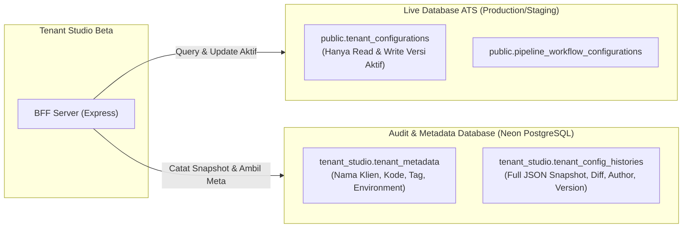
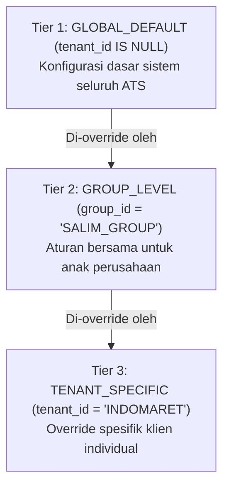
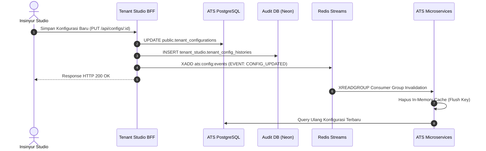
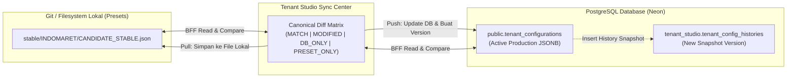

# MASTER PROJECT CONTEXT & ARCHITECTURAL HANDBOOK
## Tenant Configuration Studio (Beta) & ATS Multi-Tenant Ecosystem
> **Dokumen Panduan Konteks Lengkap untuk AI Coding Agents, Software Architects, dan Platform Engineers**  
> *Versi Dokumen: 3.0.0 (Comprehensive Context Handbook)*  
> *Target Repositori: `/Users/ketutkusuma/J/app_tenant_config_beta`*  
> *Sistem Terkait: Jobseeker ATS Platform, Neon PostgreSQL, Redis Streams Pipeline, Antigravity Customization Framework*

---

## DAFTAR ISI UTAMA
1. [BAB 1: Executive Overview & Filosofi Arsitektur](#bab-1-executive-overview--filosofi-arsitektur)
   - 1.1 Latar Belakang & Problem Statement di Industri ATS
   - 1.2 Multi-Tenant Strategy: JSONB Dynamic Configuration vs Physical Migration
   - 1.3 Misi dan Cakupan Tenant Configuration Studio
2. [BAB 2: Arsitektur Repositori Monorepo & Teknologi Pendukung](#bab-2-arsitektur-repositori-monorepo--teknologi-pendukung)
   - 2.1 Struktur Monorepo (pnpm workspaces)
   - 2.2 Arsitektur Backend-For-Frontend (`apps/bff`)
   - 2.3 Arsitektur Client Web Studio (`apps/web`)
   - 2.4 Sistem Dokumentasi, Presets, dan Customization Skills (`docs/`)
   - 2.5 Port, Script Menjalankan, dan Siklus Build
3. [BAB 3: Fondasi Database & Arsitektur Dual-Database](#bab-3-fondasi-database--arsitektur-dual-database)
   - 3.1 Pemisahan Target DB (Live ATS) dan Audit DB (Neon Serverless)
   - 3.2 Skema Tabel `public.tenant_configurations`
   - 3.3 Skema Tabel `tenant_studio.tenant_metadata`
   - 3.4 Skema Tabel `tenant_studio.tenant_config_histories` (Snapshot Versioning & Rollback)
   - 3.5 Skema Tabel `public.pipeline_workflow_configurations`
   - 3.6 Konfigurasi Pool Koneksi, SSL Require, dan Penanganan Neon Cold Starts
4. [BAB 4: Domain Taxonomy & Model Hierarki Konfigurasi](#bab-4-domain-taxonomy--model-hierarki-konfigurasi)
   - 4.1 Hierarki Tiga Tingkat: Global Default, Group Level, Tenant-Specific
   - 4.2 Taksonomi Tipe: `CANDIDATE_STABLE`
   - 4.3 Taksonomi Tipe: `APPLICANT_STABLE`
   - 4.4 Taksonomi Tipe: `VACANCY_STABLE`
   - 4.5 Taksonomi Tipe: `RECRUITMENT_PROCESS_STABLE`
   - 4.6 Taksonomi Tipe: `WORKFLOW_PIPELINE`
   - 4.7 Aturan Penggabungan (Inheritance & Deep Merge Protocol)
5. [BAB 5: Anatomi dan Tata Bahasa Dokumen JSON Konfigurasi](#bab-5-anatomi-dan-tata-bahasa-dokumen-json-konfigurasi)
   - 5.1 Root-Level Keys Specification
   - 5.2 Deep-Dive: Array `views` (Proyeksi Data & Output Serialization)
   - 5.3 Guardrail Kritis: `resolvePaths` & Pencegahan Crash Error 500 UUID
   - 5.4 Dynamic Relational Joins (`join` clause)
   - 5.5 Dynamic Subqueries (`subQuery` & `isSubQuery`)
   - 5.6 Deep-Dive: Array `validation` (Rule & Conditional Engine)
   - 5.7 Deep-Dive: Array `filterable` (Search Filters & SQL Operators)
   - 5.8 Deep-Dive: Array `decryptable` & Proteksi PII
   - 5.9 Interceptor Pipeline: `beforeExecute` & `afterExecute`
   - 5.10 Sinkronisasi `customData` & Pencegahan Invisible Fields
6. [BAB 6: Event-Driven Architecture & Redis Streams Invalidation](#bab-6-event-driven-architecture--redis-streams-invalidation)
   - 6.1 Topologi Aliran Data (Write-Through & Invalidation Pipeline)
   - 6.2 Struktur Stream Keys & Consumer Groups
   - 6.3 Skema Payload Event Redis Streams
   - 6.4 Penanganan Lag Consumer dan Error Recovery
7. [BAB 7: Spesifikasi Lengkap BFF REST API (`apps/bff`)](#bab-7-spesifikasi-lengkap-bff-rest-api-apps-bff)
   - 7.1 Tenant Metadata Endpoints
   - 7.2 Configuration Management Endpoints
   - 7.3 History & Audit Trail Endpoints
   - 7.4 Preset Files & Synchronization Endpoints
   - 7.5 Bulk Exporting & Naming Strategies
   - 7.6 Integrated Skill Exporting (`export-skill`)
   - 7.7 Error Handling, Escaping Query, dan Response Envelope
8. [BAB 8: Arsitektur Frontend & Alur Kerja Pengguna (`apps/web`)](#bab-8-arsitektur-frontend--alur-kerja-pengguna-apps-web)
   - 8.1 State Management & Navigasi Aplikasi
   - 8.2 Monaco Editor Integration & Custom Linting
   - 8.3 Algoritma Perbandingan Diff Kanonikal (`jsonDiff.ts`)
   - 8.4 Dual-Window Workspace (Live DB vs Local Preset)
   - 8.5 Sync Center Engine (Push, Pull, Matrix Status)
   - 8.6 Local Presets Drawer & Directory Manager
   - 8.7 Export Modal & Checkbox Skill Injection
   - 8.8 Interactive Technical Docs Modal
9. [BAB 9: Antigravity Skill System & Integrasi AI Pair-Programming](#bab-9-antigravity-skill-system--integrasi-ai-pair-programming)
   - 9.1 Definisi Skill `tenant-configuration`
   - 9.2 Mekanisme Progressive Disclosure
   - 9.3 Format YAML Frontmatter dan Mounted Path
   - 9.4 Bagaimana AI Lain Menggunakan Skill Ini
10. [BAB 10: Golden Rules, Guardrails & Testing Checklist untuk AI](#bab-10-golden-rules-guardrails--testing-checklist-untuk-ai)
    - 10.1 Sepuluh Aturan Emas Modifikasi Konfigurasi
    - 10.2 Anti-Patterns yang Wajib Dihindari
    - 10.3 Pre-flight Validation Checklist
    - 10.4 Checklist Pengujian Fungsional
11. [BAB 11: Production-Grade JSON Configuration Blueprints](#bab-11-production-grade-json-configuration-blueprints)
    - 11.1 Blueprint 1: `CANDIDATE_STABLE` (Enterprise Profile)
    - 11.2 Blueprint 2: `APPLICANT_STABLE` (Application Form)
    - 11.3 Blueprint 3: `VACANCY_STABLE` (Job Posting Specification)
    - 11.4 Blueprint 4: `WORKFLOW_PIPELINE` (Recruitment Funnel)
12. [BAB 12: Troubleshooting, Error Codes & Disaster Recovery](#bab-12-troubleshooting-error-codes--disaster-recovery)
    - 12.1 Penanganan Error 500 UUID Syntax Error
    - 12.2 Penanganan Missing Views pada Custom Fields
    - 12.3 Penanganan Database Pool Exhaustion
    - 12.4 Penanganan Redis Stream Consumer Timeout
    - 12.5 Prosedur Darurat Rollback Konfigurasi 1-Klik
13. [BAB 13: Glosarium Istilah & Indeks Referensi](#bab-13-glosarium-istilah--indeks-referensi)

---

# BAB 1: Executive Overview & Filosofi Arsitektur

### 1.1 Latar Belakang & Problem Statement di Industri ATS
Dalam industri perangkat lunak perekrutan (*Applicant Tracking System* / ATS), kebutuhan dari setiap perusahaan (*tenant* atau *klien*) memiliki variasi yang sangat tinggi:
- **Variasi Bidang Industri:** Perusahaan ritel massal seperti waralaba minimarket memerlukan data fisik kandidat (tinggi badan, berat badan, kesediaan bekerja shift, lokasi penempatan toko terdekat, foto full-body, nomor SIM motor). Sebaliknya, perusahaan teknologi atau konsultan keuangan memerlukan data riwayat portofolio GitHub, tautan LinkedIn, sertifikasi AWS/CFA, serta ekspektasi gaji bersih (*take-home pay*).
- **Variasi Kepatuhan & Regulasi:** Klien perbankan memiliki kewajiban regulasi untuk memeriksa riwayat OJK/SLIK, sertifikasi kepatuhan, serta nomor identitas kependudukan (KTP/NPWP) secara terenkripsi, sedangkan klien rintisan awal (*startup*) lebih mengutamakan pendaftaran cepat hanya dengan email atau nomor WhatsApp.
- **Variasi Validasi Form:** Pada satu tenant, field `expected_salary` wajib diisi (*REQUIRED*), sementara pada tenant lain field tersebut opsional atau hanya wajib jika kandidat memilih jenjang posisi manajerial (*conditional requirement*).

Sebelum adanya platform ini, tim pengembang dan tim *operations* menghadapi tantangan besar:
1. **Perubahan Langsung di Database Produksi:** Konfigurasi JSONB disimpan di tabel PostgreSQL tanpa antarmuka grafis. Operator mengubah baris database menggunakan query SQL `UPDATE` manual via DBeaver atau pgAdmin. Kesalahan 1 karakter (misal koma ekstra) menyebabkan parsing JSON gagal dan halaman portal lowongan atau dashboard recruiter *crash* (layanan mati).
2. **Ketiadaan Audit Trail Terpusat:** Tidak ada mekanisme bawaan untuk mengetahui siapa yang melakukan perubahan, kapan perubahan dilakukan, apa alasan bisnis di balik perubahan tersebut, dan tidak ada cara instan untuk melakukan rollback ke versi 1 jam yang lalu ketika terjadi komplain dari klien.
3. **Identitas Tenant Terisolasi Sebagai UUID Anonim:** Database utama hanya mencatat `tenant_id` berupa string UUID mentah (misal: `019fa680-855c-7de7-8707-0831d5761922`). Developer harus membuka tabel lain atau mencari di file spreadsheet internal hanya untuk mengetahui bahwa UUID tersebut milik "PT Indomarco Prismatama (Indomaret)".
4. **Bug Runtime yang Sangat Sulit Didiagnosa (Kasus Error 500 UUID):** Ketika developer membuat field file foto atau CV tanpa memasukkan properti `resolvePaths`, sistem ATS mencoba melakukan *type-casting* UUID attachment ke kolom entitas relational yang menghasilkan error fatal `500 invalid input syntax for type uuid`. Error ini tidak tertangkap saat JSON divalidasi dengan JSON schema umum, melainkan hanya meledak di runtime saat query dieksekusi.

---

### 1.2 Multi-Tenant Strategy: JSONB Dynamic Configuration vs Physical Migration
Terdapat tiga pendekatan umum dalam perancangan sistem SaaS multi-tenant:
1. **Database-per-Tenant (Isolated Databases):** Setiap klien memiliki database fisik terpisah. Kelebihannya adalah isolasi data absolut, tetapi kelemahannya biaya infrastruktur melambung tinggi dan eksekusi migrasi skema membutuhkan waktu lama untuk ratusan klien.
2. **Schema-per-Tenant (PostgreSQL Multi-Schema):** Satu database dengan skema berbeda (`schema_indomaret`, `schema_bank_bca`). Kelemahannya adalah kompleksitas maintenance connection pool dan query lintas skema.
3. **Shared-Table dengan JSONB Dynamic Configuration (Pendekatan ATS Jobseeker):** Satu database relasional bersama (*shared table*) di mana entitas inti (`candidates`, `applicants`, `vacancies`) menggunakan struktur kolom standar, namun proyeksi tampilan (*views*), validasi input form (*validation*), filter pencarian (*filterable*), dan aturan bisnis disimpan dalam bentuk dokumen **JSONB** di tabel `public.tenant_configurations`.

Pendekatan JSONB Dynamic Configuration memberikan fleksibilitas tak terbatas tanpa pernah memerlukan perintah berbahaya `ALTER TABLE` di database produksi yang sedang sibuk. Namun, pendekatan ini menuntut disiplin validasi dokumen yang luar biasa ketat. *Tenant Configuration Studio* dibangun untuk menjadi benteng pertahanan (*guardrail*) yang menjamin setiap dokumen JSONB memenuhi kaidah validasi sebelum menyentuh database aktif.

---

### 1.3 Misi dan Cakupan Tenant Configuration Studio
Tenant Configuration Studio Beta adalah platform internal terintegrasi yang berfungsi sebagai:
1. **Visual Management Studio:** Antarmuka web modern dengan editor berbasis VS Code (Monaco Editor) dan Dockview untuk mengedit konfigurasi secara visual.
2. **Separated Audit & History Store:** Menyimpan seluruh riwayat perubahan, metadata tenant, diff visual, dan catatan rilis pada database terpisah (Neon PostgreSQL) agar tidak membebani performa database transaksional ATS.
3. **Guardrail Pre-flight Validator:** Mesin linter otomatis yang mendeteksi kesalahan sintaks, validasi JMESPath, dependensi field relasional, dan mendeteksi ketiadaan `resolvePaths` pada berkas file sebelum data dikirim ke database.
4. **Canonical Sync Center:** Sistem komparasi dua arah (*two-way comparison*) antara database aktif dan katalog file preset lokal di filesystem pengembang, lengkap dengan kalkulasi delta kanonikal RFC 6902.
5. **Integrated AI Agent Skill Packaging:** Kemampuan mengekspor seluruh konfigurasi beserta paket keahlian kecerdasan buatan (*Skill tenant-configuration / SKILL.md*) sehingga AI pair-programmer manapun (seperti Antigravity atau Gemini CLI) dapat langsung memahami konteks proyek secara mandiri.

---

# BAB 2: Arsitektur Repositori Monorepo & Teknologi Pendukung

### 2.1 Struktur Monorepo (pnpm workspaces)
Repositori ini dirancang menggunakan arsitektur monorepo modern yang dikelola dengan `pnpm`:

```text
/Users/ketutkusuma/J/app_tenant_config_beta/
├── .env                              # Variabel lingkungan lokal (DB credentials, Ports)
├── .env.example                      # Template referensi variabel lingkungan
├── package.json                      # Root manifest & orkestrasi skrip
├── pnpm-workspace.yaml               # Konfigurasi workspace pnpm (apps/*)
├── pnpm-lock.yaml                    # Dependency lockfile
├── README.md                         # Dokumentasi umum aplikasi
├── apps/
│   ├── bff/                          # Backend-For-Frontend (Node.js + Express + TypeScript)
│   │   ├── package.json
│   │   ├── tsconfig.json
│   │   ├── dist/                     # Hasil kompilasi JavaScript
│   │   └── src/
│   │       └── main.ts               # Server utama, database pools, REST endpoints
│   └── web/                          # Client Frontend (React 18 + Vite 6 + Tailwind CSS)
│       ├── package.json
│       ├── tsconfig.json
│       ├── vite.config.ts            # Konfigurasi Vite & proxy /api ke localhost:4000
│       ├── tailwind.config.js
│       ├── postcss.config.js
│       ├── index.html
│       ├── dist/                     # Hasil build statis untuk produksi
│       └── src/
│           ├── main.tsx              # Entry point React DOM
│           ├── index.css             # Tailwind base & custom utility styles
│           ├── App.tsx               # Orchestrator utama state & layout studio
│           ├── components/
│           │   └── DocsModal.tsx     # Modal dokumentasi teknis interaktif
│           └── utils/
│               └── jsonDiff.ts       # Engine komparasi kanonikal & RFC 6902 delta
└── docs/                             # Dokumentasi arsitektur, checklist, dan skills
    ├── TENANT_CONFIGURATION_GUIDE.md # Panduan komprehensif manual
    ├── TEST_CASES_CHECKLIST.md       # 15 skenario pengujian & regresi
    ├── AI_PROJECT_CONTEXT_HANDBOOK.md # File handbook ini
    └── skills/
        └── tenant-configuration/
            └── SKILL.md              # Master AI Skill untuk Antigravity / Gemini
```

---

### 2.2 Arsitektur Backend-For-Frontend (`apps/bff`)
BFF bertindak sebagai fasilitator komunikasi antara client web, database ATS produksi, database audit terpisah, dan sistem file lokal:
- **Teknologi Inti:** Express 4.x, TypeScript 5.7, Node.js (didukung `tsx` untuk eksekusi dev tanpa build step terpisah).
- **PostgreSQL Client (`pg`):** Menggunakan dua connection pool independen (`targetDb` untuk tabel aktif `public.tenant_configurations` dan `auditDb` untuk schema `tenant_studio`).
- **Eksekusi Aman:** Sanitasi input query melalui helper escaping kustom (`esc()`) untuk mencegah SQL Injection pada Neon SQL proxy.
- **Katalog Preset Filesystem:** Mengakses direktori lokal pengguna (default: `/Users/ketutkusuma/Python/test_redis_stream/stable`) untuk membaca, membandingkan, menyimpan, dan mengekspor preset JSON.
- **Skill Provisioner:** Bertanggung jawab menduplikasi dan mendistribusikan `SKILL.md` serta panduan teknis ke dalam subfolder `.agents/skills/tenant-configuration/` pada folder target preset.

---

### 2.3 Arsitektur Client Web Studio (`apps/web`)
Aplikasi web dirancang khusus untuk kenyamanan para insinyur backend dan platform operations:
- **Framework:** React 18 dengan TypeScript dan bundler Vite 6 (mendukung *Hot Module Replacement* instan).
- **Styling:** Tailwind CSS dengan palet warna bernuansa gelap (*Dark Mode*: slate-900, slate-950, indigo-600, amber-500, emerald-500).
- **Monaco Code Editor (`@monaco-editor/react`):** Mesin editor yang sama dengan Visual Studio Code. Dilengkapi dengan syntax highlighting JSON, auto-completion, line numbers, folding, serta DiffEditor untuk visualisasi perubahan samping-menyamping (*side-by-side split*).
- **Dockview (`dockview`):** Engine layout berbasis tab dan tiling yang memungkinkan pemisahan panel fleksibel (split horizontal/vertikal).
- **Lucide React (`lucide-react`):** Set ikon antarmuka yang konsisten dan informatif.

---

### 2.4 Sistem Dokumentasi, Presets, dan Customization Skills (`docs/`)
Repositori ini tidak hanya menyimpan kode, tetapi juga menyertakan ekosistem pengetahuan mandiri:
- **`docs/TENANT_CONFIGURATION_GUIDE.md`:** Panduan tertulis bagi insinyur baru yang membahas setiap field konfigurasi dan pencegahan error secara mendalam.
- **`docs/TEST_CASES_CHECKLIST.md`:** 15 skenario uji pengujian sistem, mencakup verifikasi editor, sinkronisasi dua arah, export masal, audit trail, hingga skenario penanganan kegagalan jaringan.
- **`docs/skills/tenant-configuration/SKILL.md`:** Spesifikasi formal Antigravity Skill System. Memuat YAML frontmatter lengkap sehingga ketika dipasang di lingkungan AI IDE, asisten kecerdasan buatan langsung memiliki pemahaman tingkat tinggi mengenai struktur data ATS tanpa perlu dilatih ulang.

---

### 2.5 Port, Script Menjalankan, dan Siklus Build

#### Port Standar:
- **Client Frontend (Vite Dev Server):** `http://localhost:3000`
- **BFF Server (Express API):** `http://localhost:4000` (diteruskan via reverse proxy Vite di path `/api/*`).

#### Perintah Manajemen Proyek:
```bash
# Menjalankan seluruh aplikasi (BFF + Web) secara paralel dalam mode development:
pnpm dev

# Menjalankan hanya server BFF:
pnpm dev:bff

# Menjalankan hanya server Web:
pnpm dev:web

# Melakukan kompilasi TypeScript dan produksi build di seluruh workspace:
pnpm build

# Memeriksa build pada masing-masing workspace secara terisolasi:
pnpm --filter bff build
pnpm --filter web build
```

---

# BAB 3: Fondasi Database & Arsitektur Dual-Database

### 3.1 Pemisahan Target DB (Live ATS) dan Audit DB (Neon Serverless)
Untuk menjaga integritas dan performa sistem ATS produksi, arsitektur database sengaja dipisahkan secara fisik menjadi dua cluster:



#### Alasan Desain Pemisahan:
1. **Pencegahan Overhead I/O di Database Utama:** Menyimpan seluruh riwayat versi JSONB (yang ukurannya bisa mencapai 100KB per versi) di database utama ATS akan menyebabkan pembengkakan tabel (*table bloat*) dan memperlambat pencarian indeks transaksional.
2. **Isolasi Kegagalan:** Jika cluster audit mengalami gangguan atau *rate limit*, operasi pembacaan konfigurasi inti oleh aplikasi ATS tetap berjalan normal tanpa gangguan.
3. **Pemberian Metadata Manusiawi Tanpa Mengubah Skema ATS:** Database ATS asli tidak memiliki kolom `client_name` atau `client_code` pada tabel konfigurasi. Metadata tersebut dikelola secara independen di schema `tenant_studio` pada database audit.

---

### 3.2 Skema Tabel `public.tenant_configurations`
Tabel ini bertempat di database utama ATS dan merupakan satu-satunya sumber kebenaran (*single source of truth*) yang dibaca oleh microservice ATS di runtime:

```sql
CREATE TABLE IF NOT EXISTS public.tenant_configurations (
    id UUID PRIMARY KEY DEFAULT gen_random_uuid(),
    tenant_id VARCHAR(64) NULL,               -- NULL menandakan konfigurasi GLOBAL DEFAULT
    group_id VARCHAR(64) NULL,                -- Digunakan jika konfigurasi berlaku untuk grup konglomerasi
    config_type VARCHAR(64) NOT NULL,         -- Jenis: CANDIDATE_STABLE, APPLICANT_STABLE, dll
    path VARCHAR(255) NULL,                   -- Sub-path opsional (contoh: applicant/administrative.basic)
    value JSONB NOT NULL DEFAULT '{}'::jsonb, -- Dokumen konfigurasi dinamis
    created_at TIMESTAMP WITH TIME ZONE DEFAULT CURRENT_TIMESTAMP,
    updated_at TIMESTAMP WITH TIME ZONE DEFAULT CURRENT_TIMESTAMP,
    created_by VARCHAR(64) NULL,
    updated_by VARCHAR(64) NULL
);

-- Indeks unik untuk mencegah duplikasi konfigurasi per tenant & tipe
CREATE UNIQUE INDEX IF NOT EXISTS uq_tenant_config_type_path 
ON public.tenant_configurations (
    COALESCE(tenant_id, 'GLOBAL_DEFAULT'), 
    config_type, 
    COALESCE(path, '')
);

-- Indeks GIN pada kolom JSONB untuk mempercepat query filtering backend
CREATE INDEX IF NOT EXISTS idx_tenant_config_value_gin 
ON public.tenant_configurations USING GIN (value);
```

---

### 3.3 Skema Tabel `tenant_studio.tenant_metadata`
Tabel ini bertempat di database audit untuk memberikan identitas bisnis pada setiap `tenant_id`:

```sql
CREATE SCHEMA IF NOT EXISTS tenant_studio;

CREATE TABLE IF NOT EXISTS tenant_studio.tenant_metadata (
    id UUID PRIMARY KEY DEFAULT gen_random_uuid(),
    tenant_id VARCHAR(64) UNIQUE NOT NULL,    -- UUID tenant yang berelasi dengan sistem ATS
    client_name VARCHAR(255) NOT NULL,        -- Nama resmi perusahaan (contoh: PT Indomarco Prismatama)
    client_code VARCHAR(64) NOT NULL,         -- Kode singkat unik (contoh: INDOMARET)
    environment VARCHAR(32) NOT NULL DEFAULT 'production', -- 'production' | 'staging' | 'sandbox'
    is_active BOOLEAN NOT NULL DEFAULT true,
    tags TEXT[] DEFAULT ARRAY[]::TEXT[],      -- Contoh: ARRAY['retail', 'enterprise', 'high-volume']
    notes TEXT NULL,
    created_at TIMESTAMP WITH TIME ZONE DEFAULT CURRENT_TIMESTAMP,
    updated_at TIMESTAMP WITH TIME ZONE DEFAULT CURRENT_TIMESTAMP
);

CREATE INDEX IF NOT EXISTS idx_tenant_metadata_code 
ON tenant_studio.tenant_metadata (client_code);
```

---

### 3.4 Skema Tabel `tenant_studio.tenant_config_histories`
Tabel ini mencatat setiap perubahan yang terjadi pada konfigurasi, menyimpan snapshot utuh, diff perubahan, dan nama pembuat perubahan:

```sql
CREATE TABLE IF NOT EXISTS tenant_studio.tenant_config_histories (
    id UUID PRIMARY KEY DEFAULT gen_random_uuid(),
    core_config_id VARCHAR(64) NOT NULL,      -- ID baris konfigurasi di public.tenant_configurations
    tenant_id VARCHAR(64) NULL,
    group_id VARCHAR(64) NULL,
    config_type VARCHAR(64) NOT NULL,
    version INT NOT NULL DEFAULT 1,           -- Nomor versi berurutan (1, 2, 3...)
    config_value JSONB NOT NULL,              -- Full JSON snapshot pada saat versi dibuat
    change_summary VARCHAR(500) NULL,         -- Ringkasan deskriptif perubahan (dibuat user / AI)
    diff_json JSONB NULL,                     -- Rincian RFC 6902 delta operasi (add, remove, replace)
    author_name VARCHAR(128) NOT NULL DEFAULT 'System Admin',
    created_at TIMESTAMP WITH TIME ZONE DEFAULT CURRENT_TIMESTAMP
);

CREATE INDEX IF NOT EXISTS idx_histories_core_id 
ON tenant_studio.tenant_config_histories (core_config_id, version DESC);
```

---

### 3.5 Skema Tabel `public.pipeline_workflow_configurations`
Tabel khusus untuk mengatur pipeline dan workflow rekrutmen kustom:

```sql
CREATE TABLE IF NOT EXISTS public.pipeline_workflow_configurations (
    id UUID PRIMARY KEY DEFAULT gen_random_uuid(),
    tenant_id VARCHAR(64) NOT NULL,
    workflow_name VARCHAR(128) NOT NULL,
    stages JSONB NOT NULL DEFAULT '[]'::jsonb, -- Definisi stage (Applied, Screening, Interview, Offered)
    automations JSONB NOT NULL DEFAULT '{}'::jsonb, -- Action otomatis (kirim email, kirim WA, undang tes)
    is_default BOOLEAN NOT NULL DEFAULT false,
    created_at TIMESTAMP WITH TIME ZONE DEFAULT CURRENT_TIMESTAMP,
    updated_at TIMESTAMP WITH TIME ZONE DEFAULT CURRENT_TIMESTAMP
);
```

---

### 3.6 Konfigurasi Pool Koneksi, SSL Require, dan Penanganan Neon Cold Starts
Pada lingkungan modern (seperti Neon Serverless PostgreSQL), koneksi database dapat tertidur (*sleep*) saat tidak ada lalu lintas data, dan memerlukan parameter SSL ketat:

1. **Variabel Lingkungan `.env`:**
   ```env
   # Target Database (ATS DB)
   DB_HOST=ep-example-ats-pooler.ap-southeast-1.aws.neon.tech
   DB_PORT=5432
   DB_NAME=ats_db
   DB_USER=ats_admin
   DB_PASS=secret_ats_password
   DB_SSL=require

   # Audit Database (NeonDB Terpisah)
   AUDIT_DB_HOST=ep-example-audit-pooler.ap-southeast-1.aws.neon.tech
   AUDIT_DB_PORT=5432
   AUDIT_DB_NAME=audit_db
   AUDIT_DB_USER=audit_admin
   AUDIT_DB_PASS=secret_audit_password
   AUDIT_DB_SSL=require
   ```

2. **Inisialisasi Pool pada `apps/bff/src/main.ts`:**
   ```typescript
   const targetDb = new Pool({
     ...getTargetDbConfig(),
     max: 10,                    // Membatasi koneksi agar tidak melebihi kuota pooler serverless
     idleTimeoutMillis: 30000,   // Melepas koneksi idle setelah 30 detik
     connectionTimeoutMillis: 10000 // Timeout 10 detik untuk mengantisipasi wake-up latency Neon
   });
   ```

---

# BAB 4: Domain Taxonomy & Model Hierarki Konfigurasi

### 4.1 Hierarki Tiga Tingkat: Global Default, Group Level, Tenant-Specific
Resolusi konfigurasi di runtime ATS menggunakan algoritma pewarisan hirarkis bertingkat tiga (*Three-Tier Hierarchical Resolution*):



1. **Tier 1 - Global Default (`tenant_id IS NULL`):** Menyediakan fallback universal. Jika sebuah tenant baru mendaftar dan belum dikonfigurasi, ATS akan secara otomatis merujuk ke baris Global Default.
2. **Tier 2 - Group Level (`group_id IS NOT NULL`):** Digunakan untuk kelompok holding konglomerasi (contoh: Salim Group yang menaungi Indomaret, Indofood, Bogasari). Aturan SSO atau validasi nomor induk karyawan grup didefinisikan di sini.
3. **Tier 3 - Tenant-Specific (`tenant_id = '019fa...'`):** Tingkat prioritas tertinggi. Setiap nilai properti yang didefinisikan di sini akan mengesampingkan (*override*) konfigurasi group dan global.

---

### 4.2 Taksonomi Tipe: `CANDIDATE_STABLE`
Mengatur model profil kandidat terpusat (Master Candidate Profile):
- Informasi pribadi: Nama, NIK, Tempat/Tanggal Lahir, Jenis Kelamin, Agama, Golongan Darah, Status Pernikahan.
- Informasi kontak: Email, No WhatsApp, No Telepon Darurat, Akun Media Sosial.
- Informasi kualifikasi: Riwayat Pendidikan Formal, Pengalaman Kerja, Sertifikasi Keahlian, Kemampuan Bahasa, Riwayat Organisasi.
- Berkas profil: Pas Foto, Curriculum Vitae (CV), Kartu Tanda Penduduk (KTP), Surat Keterangan Catatan Kepolisian (SKCK), Ijazah Terakhir.

---

### 4.3 Taksonomi Tipe: `APPLICANT_STABLE`
Mengatur formulir lamaran kerja spesifik pada suatu lowongan:
- Kuisioner skrining awal (*knockout questions*): "Apakah Anda bersedia ditempatkan di luar pulau?", "Berapa lama periode notice-period Anda?".
- Pengunggahan berkas lamaran: Surat Lamaran Kerja (*Cover Letter*), Portofolio Khusus, Slip Gaji Terakhir.
- Pengaturan kriteria seleksi administratif otomatis.

---

### 4.4 Taksonomi Tipe: `VACANCY_STABLE`
Mengatur konfigurasi pembuatan dan publikasi lowongan kerja oleh recruiter/HR:
- Struktur field lowongan: Judul Posisi, Departemen, Jenjang Karir, Rentang Gaji (Ditampilkan / Disembunyikan), Lokasi Kerja (Onsite, Remote, Hybrid).
- Alur persetujuan posting lowongan (*Vacancy Approval Flow*).
- Visibilitas lowongan: Publik di Portal Karir, Internal Perusahaan Saja, atau Private (hanya via tautan khusus).

---

### 4.5 Taksonomi Tipe: `RECRUITMENT_PROCESS_STABLE`
Mengatur parameter operasional seleksi:
- Tahapan proses: Seleksi Administrasi, Tes Psikotes Online, Wawancara HR, Wawancara User, Medical Check-Up (MCU), Penawaran Kerja (*Offering*).
- Template formulir penilaian wawancara (*Interview Scorecard*).

---

### 4.6 Taksonomi Tipe: `WORKFLOW_PIPELINE`
Mengatur otomasi transisi status kandidat:
- Pemicu (*triggers*): Ketika kandidat dipindahkan dari tahap `Screening` ke `Interview`.
- Tindakan (*actions*): Kirim email undangan otomatis via SendGrid, kirim notifikasi WhatsApp via Twilio/WABA, buat jadwal meeting di Google Calendar.

---

# BAB 5: Anatomi dan Tata Bahasa Dokumen JSON Konfigurasi

### 5.1 Root-Level Keys Specification
Sebuah dokumen konfigurasi ATS yang valid memiliki 10 properti tingkat atas (*root keys*):

| Root Key | Tipe Data | Status | Fungsi Utama |
| :--- | :--- | :--- | :--- |
| `views` | `Array<ViewItem>` | **Wajib (Kritis)** | Mendefinisikan serialisasi output, alias kolom, JMESPath, SQL JOIN, subquery, dan resolver URL berkas. |
| `filterable` | `Array<FilterItem>` | Opsional | Mendefinisikan kolom yang diizinkan untuk disaring di API dan antarmuka pencarian. |
| `validation` | `Array<ValidationItem>` | Opsional | Mendefinisikan aturan validasi form input (Wajib, Regex, Kondisional, Rentang). |
| `decryptable` | `Array<string>` | Opsional | Daftar field rahasia PII yang wajib didekripsi secara aman sebelum dikirim ke client. |
| `searchable` | `Array<string>` | Opsional | Daftar kolom yang diikutkan dalam pencarian teks global (*full-text search*). |
| `beforeExecute`| `Array<ActionInterceptor>`| Opsional | Interceptor logika bisnis yang dijalankan sebelum query database dieksekusi. |
| `afterExecute` | `Array<ActionInterceptor>`| Opsional | Interceptor transformasi payload setelah database mengembalikan baris data. |
| `customData` | `Object` | Opsional | Definisi custom field spesifik tenant yang tidak ada di skema standar ATS. |
| `moduleReferences`| `Array<ModuleRef>` | Opsional | Referensi modul eksternal (misal: modul asesmen psikotes pihak ketiga). |
| `rules` | `Array<BusinessRule>` | Opsional | Aturan bisnis kondisional tingkat tinggi. |

---

### 5.2 Deep-Dive: Array `views` (Proyeksi Data & Output Serialization)
Array `views` adalah komponen paling vital. Setiap elemen merepresentasikan sebuah properti yang akan diekspos ke antarmuka ATS:

```json
{
  "view": "profile_photo",
  "source": "c.photo_media_id",
  "type": "file",
  "display": "Pas Foto Kandidat",
  "resolvePaths": ["url", "thumbnail_url"],
  "filterable": false,
  "sortable": false
}
```

#### Struktur Properti ViewItem:
1. `view` (String, Wajib): Nama kunci JSON yang akan diterima oleh frontend ATS.
2. `source` (String, Wajib): Ekspresi sumber data. Dapat berupa:
   - Nama kolom fisik tabel (`c.email`, `c.full_name`).
   - Ekspresi JSONB JMESPath (`c.additional_info.uniform_size`).
   - Ekspresi fungsi SQL (`CONCAT(c.first_name, ' ', c.last_name)`).
3. `type` (String, Wajib): Tipe data (`string`, `number`, `boolean`, `date`, `file`, `json`, `array`).
4. `display` (String, Opsional): Label manusiawi yang ditampilkan pada header tabel recruiter.
5. `resolvePaths` (Array<string>, **Kritis untuk tipe file**): Menentukan atribut URL yang harus digenerate oleh S3/GCS signer.
6. `join` (Object, Opsional): Definisi relasi SQL JOIN dinamis.
7. `subQuery` / `isSubQuery` (Boolean & String, Opsional): Definisi subquery kustom.

---

### 5.3 Guardrail Kritis: `resolvePaths` & Pencegahan Crash Error 500 UUID

> [!CAUTION]
> **ATURAN MUTLAK PENYELAMAT PRODUKSI:**  
> Setiap kali mendefinisikan view dengan `type: "file"` atau sumber data yang mereferensikan tabel media attachments, Anda **WAJIB** menyertakan array `resolvePaths: ["url", ...]`!

#### Kronologi Error 500:
1. Di database, kolom seperti `c.resume_file` sebenarnya hanya menyimpan string UUID media (misal: `"3fa85f64-5717-4562-b3fc-2c963f66afa6"`).
2. Ketika frontend ATS meminta data, pipeline `afterExecute` akan mengeksekusi fungsi `ResolveFileUrls`.
3. Jika `resolvePaths` **LUPA DITULIS**, sistem ATS menganggap view tersebut adalah kolom entitas UUID biasa dan berusaha melakukan type-cast ke UUID relational tanpa mengonversinya menjadi URL unduhan S3/GCS.
4. Akibatnya, query meledak dengan pesan error fatal:  
   `HTTP 500: invalid input syntax for type uuid: "https://storage.googleapis.com/..."`  
   atau sebaliknya query gagal membaca file ID dan merusak seluruh daftar tabel kandidat.

#### Contoh Penulisan yang Benar vs Salah:
```json
// SALAH (AKAN MEMICU CRASH RUNTIME 500):
{
  "view": "curriculum_vitae",
  "source": "c.cv_attachment_id",
  "type": "file"
}

// BENAR (LENGKAP DENGAN RESOLVEPATHS):
{
  "view": "curriculum_vitae",
  "source": "c.cv_attachment_id",
  "type": "file",
  "resolvePaths": ["url", "download_url", "file_name", "size_bytes"]
}
```

---

### 5.4 Dynamic Relational Joins (`join` clause)
Ketika data yang dibutuhkan berada di tabel relasional lain, gunakan properti `join`:

```json
{
  "view": "latest_education_degree",
  "source": "edu.degree_name",
  "type": "string",
  "join": {
    "table": "candidate_educations",
    "alias": "edu",
    "type": "LEFT",
    "on": "edu.candidate_id = c.id AND edu.is_latest = true"
  }
}
```

---

### 5.5 Dynamic Subqueries (`subQuery` & `isSubQuery`)
Jika sebuah field membutuhkan agregasi tanpa mengacaukan baris tabel utama:

```json
{
  "view": "total_applications_count",
  "type": "number",
  "isSubQuery": true,
  "subQuery": "SELECT COUNT(*) FROM applicants a WHERE a.candidate_id = c.id"
}
```

---

### 5.6 Deep-Dive: Array `validation` (Rule & Conditional Engine)
Memvalidasi payload data sebelum disimpan ke database:

```json
{
  "validation": [
    {
      "field": "nik",
      "type": "REGEX",
      "rule": "^[0-9]{16}$",
      "message": "Nomor Induk Kependudukan (NIK) harus tepat 16 digit angka."
    },
    {
      "field": "driving_license_number",
      "type": "REQUIRED",
      "when": {
        "field": "has_driving_license",
        "operator": "EQUALS",
        "value": true
      },
      "message": "Nomor SIM wajib diisi jika Anda menyatakan memiliki SIM."
    }
  ]
}
```

#### Tipe Operator `when` pada Validasi Kondisional:
- `EQUALS`: Nilai field harus sama persis.
- `NOT_EQUALS`: Nilai field tidak boleh sama.
- `IN`: Nilai field berada di dalam himpunan array.
- `GREATER_THAN` / `LESS_THAN`: Perbandingan numerik atau tanggal.

---

### 5.7 Deep-Dive: Array `filterable` (Search Filters & SQL Operators)
Mengontrol field mana yang dapat difilter oleh recruiter di antarmuka ATS:

```json
{
  "filterable": [
    {
      "key": "expected_salary",
      "inputType": "number_range",
      "operator": "BETWEEN",
      "column": "c.expected_salary"
    },
    {
      "key": "domicile_city",
      "inputType": "select_multiple",
      "operator": "IN",
      "column": "c.city_id"
    }
  ]
}
```

---

### 5.8 Deep-Dive: Array `decryptable` & Proteksi PII
Data pribadi yang sensitif (*Personally Identifiable Information*) wajib dienkripsi saat diam (*at-rest*) di PostgreSQL:

```json
{
  "decryptable": [
    "nik",
    "tax_id",
    "bank_account_number",
    "current_salary"
  ]
}
```
Ketika field-field ini diakses, pipeline ATS akan memanggil modul enkripsi internal (`kms_decrypt`) hanya jika pengguna memiliki hak akses role `HR_MANAGER` atau `SUPER_ADMIN`.

---

### 5.9 Interceptor Pipeline: `beforeExecute` & `afterExecute`
Mengontrol lifecycle eksekusi:

```json
{
  "beforeExecute": [
    {
      "handler": "InjectTenantContext",
      "params": { "enforceTenantIsolation": true }
    },
    {
      "handler": "ValidateFormRules"
    }
  ],
  "afterExecute": [
    {
      "handler": "ResolveFileUrls",
      "params": { "expiryMinutes": 60 }
    },
    {
      "handler": "ResolveEncryptedFields"
    }
  ]
}
```

---

### 5.10 Sinkronisasi `customData` & Pencegahan Invisible Fields
Sebuah kesalahan fatal yang sering dilakukan adalah mendefinisikan field kustom di `customData.fields`, namun lupa mendaftarkannya di array `views`:

```json
// JIKA HANYA MENULIS INI:
{
  "customData": {
    "fields": [
      { "key": "shoe_size", "label": "Ukuran Sepatu Safety", "type": "number" }
    ]
  }
}
```
**Dampaknya:** Kandidat dapat mengisi ukuran sepatu di formulir lamaran kerja, data tersimpan di kolom JSONB database, **TETAPI RECRUITER TIDAK PERNAH BISA MELIHAT, MENYARING, MAUPUN MENGEKSPOR KOLOM TERSEBUT DI TABEL KANDIDAT!**  
**Solusi Wajib:** Selalu tambahkan pasangannya di array `views`:
```json
{
  "view": "shoe_size",
  "source": "c.custom_data.shoe_size",
  "type": "number",
  "display": "Ukuran Sepatu Safety"
}
```

---

# BAB 6: Event-Driven Architecture & Redis Streams Invalidation

### 6.1 Topologi Aliran Data (Write-Through & Invalidation Pipeline)
Aplikasi microservices ATS tidak membaca database setiap detik karena beban request pencarian kandidat sangat tinggi. Sebagai gantinya, konfigurasi di-cache di memori lokal (*in-memory Redis Cache*). Ketika Tenant Studio melakukan pembaruan konfigurasi, sebuah event wajib dikirim ke Redis Streams untuk membatalkan cache tersebut:



---

### 6.2 Struktur Stream Keys & Consumer Groups
- **Nama Stream Utama:** `ats:config:events`
- **Consumer Group Utama:** `ats_config_invalidator_group`
- **Nama Event:**
  - `CONFIG_CREATED`: Konfigurasi tenant baru ditambahkan.
  - `CONFIG_UPDATED`: Isi dokumen JSONB diperbarui.
  - `CONFIG_DELETED`: Konfigurasi dihapus (kembali ke Global Default).
  - `CONFIG_ROLLED_BACK`: Versi konfigurasi dikembalikan ke masa lalu.

---

### 6.3 Skema Payload Event Redis Streams
Payload event dikirim menggunakan perintah Redis `XADD`:

```json
{
  "eventId": "1728704400000-0",
  "eventType": "CONFIG_UPDATED",
  "tenantId": "019fa680-855c-7de7-8707-0831d5761922",
  "configType": "CANDIDATE_STABLE",
  "version": 4,
  "authorName": "Ketut Kusuma",
  "timestamp": "2026-10-12T10:15:00.000Z"
}
```

---

# BAB 7: Spesifikasi Lengkap BFF REST API (`apps/bff`)

### 7.1 Tenant Metadata Endpoints
1. `GET /api/tenants`  
   Mengembalikan seluruh daftar tenant beserta metadata lengkap (Nama Klien, Kode Klien, Environment, Status).
2. `POST /api/tenants`  
   Mendaftarkan metadata tenant baru ke schema `tenant_studio.tenant_metadata`.

---

### 7.2 Configuration Management Endpoints
1. `GET /api/configs`  
   Mengambil seluruh konfigurasi dari `public.tenant_configurations`. Mendukung filter `?tenantId=...`.
2. `GET /api/configs/:id`  
   Mengambil 1 baris konfigurasi lengkap berdasarkan ID.
3. `PUT /api/configs/:id`  
   Memperbarui dokumen JSON konfigurasi. Secara otomatis mencatat riwayat versi baru ke tabel histories.
4. `DELETE /api/configs/:id`  
   Menghapus konfigurasi spesifik tenant (menjadikan tenant tersebut kembali menggunakan Global Default).

---

### 7.3 History & Audit Trail Endpoints
1. `GET /api/configs/:configId/histories`  
   Mengambil daftar seluruh riwayat versi untuk sebuah konfigurasi (diurutkan dari versi terbaru `version DESC`).
2. `POST /api/configs/:configId/rollback`  
   Melakukan rollback konfigurasi aktif ke nomor versi masa lalu tertentu dalam 1 transaksi atomik.

---

### 7.4 Preset Files & Synchronization Endpoints
1. `GET /api/references?dir=...`  
   Membaca seluruh file preset berformat `.json` dari direktori lokal filesystem pengguna.
2. `GET /api/references/file?path=...`  
   Membaca isi JSON dari sebuah path file preset lokal.
3. `POST /api/references/save`  
   Menyimpan atau memperbarui dokumen JSON ke dalam 1 file preset lokal. Menerima parameter `includeSkill: boolean` untuk menyertakan file `SKILL.md`.
4. `POST /api/references/sync-single`  
   Menyinkronkan isi dari file preset lokal langsung ke baris database konfigurasi aktif.

---

### 7.5 Bulk Exporting & Naming Strategies
`POST /api/references/export-bulk`  
Mengekspor banyak konfigurasi sekaligus dari database ke folder preset lokal:
- Parameter `scope`: `"current_tenant"` | `"all_tenants"`.
- Parameter `namingStrategy`:
  - `"config_type"`: Menyimpan sebagai `<CONFIG_TYPE>.json` (contoh: `CANDIDATE_STABLE.json`).
  - `"tenant_folder"`: Menyimpan dalam subfolder tenant (contoh: `INDOMARET/CANDIDATE_STABLE.json`).
  - `"path"`: Menyimpan sesuai kolom `path` di database.
- Parameter `includeSkill`: `boolean` (Default: `true`).

---

### 7.6 Integrated Skill Exporting (`export-skill`)
`POST /api/references/export-skill`  
Secara eksplisit menyalin seluruh file spesifikasi AI Agent:
- Menyalin master `docs/skills/tenant-configuration/SKILL.md` ke `<targetDir>/skills/tenant-configuration/SKILL.md`.
- Menyalin ke `<targetDir>/.agents/skills/tenant-configuration/SKILL.md` (Standar workspace Antigravity).
- Menyalin `docs/TENANT_CONFIGURATION_GUIDE.md` ke `<targetDir>/TENANT_CONFIGURATION_GUIDE.md`.

---

# BAB 8: Arsitektur Frontend & Alur Kerja Pengguna (`apps/web`)

### 8.1 State Management & Navigasi Aplikasi
Aplikasi dikelola secara reaktif pada `apps/web/src/App.tsx`:
- `tenants`: Daftar tenant yang dimuat dari database audit.
- `selectedTenant`: Tenant yang saat ini aktif dipilih pada dropdown switcher atas.
- `configs`: Daftar seluruh konfigurasi milik tenant yang sedang dipilih.
- `selectedConfigId`: ID konfigurasi yang sedang dibuka di editor kode.
- `jsonContent`: String isi dokumen konfigurasi yang sedang disunting di Monaco Editor.
- `references`: Daftar katalog file preset lokal yang ditemukan pada direktori komputer pengguna.
- `presetDirPath`: Lokasi direktori preset lokal (Default: `/Users/ketutkusuma/Python/test_redis_stream/stable`).

---

### 8.2 Monaco Editor Integration & Custom Linting
- **Theme:** `vs-dark` yang disesuaikan dengan skema warna studio.
- **Language:** `json` dengan opsi format on paste dan format on type.
- **Linter Internal:** Sebelum tombol simpan dapat ditekan, parser mengecek validitas JSON dan memverifikasi ketiadaan syntax error.

---

### 8.3 Algoritma Perbandingan Diff Kanonikal (`jsonDiff.ts`)
Salah satu tantangan terbesar komparasi JSON adalah **urutan kunci (*key ordering*)**. Dua dokumen JSON yang memiliki data identik bisa terlihat berbeda jika kunci pada dokumen A berurutan `{"a": 1, "b": 2}` sedangkan dokumen B berurutan `{"b": 2, "a": 1}`.

`apps/web/src/utils/jsonDiff.ts` mengimplementasikan algoritma kanonikal:
1. **Fungsi `canonicalSort(obj)`:** Mengurutkan seluruh kunci objek secara alfabetis rekursif ke seluruh kedalaman tree.
2. **Kalkulasi RFC 6902 Patch:** Menghasilkan array operasi formal `add`, `remove`, dan `replace`.
3. **Analisis Khusus Array `views`:** Membandingkan array `views` berdasarkan identitas properti `view` (bukan sekadar indeks array), sehingga pemindahan posisi view tidak dianggap sebagai penghapusan data.

---

### 8.4 Dual-Window Workspace (Live DB vs Local Preset)
Fitur **Split Screen** membagi antarmuka menjadi dua panel berdampingan:
- **Panel Kiri (Database Aktif):** Menampilkan konfigurasi yang sedang berjalan di PostgreSQL.
- **Panel Kanan (Preset Lokal):** Menampilkan konfigurasi dari file `.json` di komputer pengembang.
- Memungkinkan recruiter/developer menyalin field atau membandingkan perbedaan secara langsung.

---

### 8.5 Sync Center Engine (Push, Pull, Matrix Status)
Modal **Sync Center** menyajikan tabel komparasi komprehensif antara seluruh konfigurasi tenant di database dengan seluruh file preset di folder lokal:
- Status **MATCH (Hijau):** Konfigurasi di database dan file preset 100% identik.
- Status **MODIFIED (Kuning):** Terdapat perbedaan isi dokumen (dapat diklik untuk melihat Diff).
- Status **DB_ONLY (Biru):** Ada di database tetapi belum memiliki file preset lokal.
- Status **PRESET_ONLY (Ungu):** Ada di folder preset lokal tetapi belum ada di database.
- Tombol **Push (Preset -> DB):** Mengirim versi file lokal ke database.
- Tombol **Pull (DB -> Preset):** Mengunduh versi database ke file lokal.

---

### 8.6 Export Modal & Checkbox Skill Injection
Ketika pengguna mengklik tombol **"Ekspor Preset"**, modal akan menyajikan:
- Pemilihan cakupan: 1 file, semua file tenant ini, atau seluruh database.
- Input path direktori tujuan ekspor.
- **Checkbox: "Sertakan Skill tenant_config (SKILL.md & Panduan)":** Memastikan file keahlian AI otomatis diikutsertakan di dalam folder ekspor.

---

# BAB 9: Antigravity Skill System & Integrasi AI Pair-Programming

### 9.1 Definisi Skill `tenant-configuration`
Skill adalah direktori instruksi mandiri yang dibaca oleh asisten coding kecerdasan buatan (seperti Google Antigravity, Claude Code, atau Gemini CLI). Lokasi master skill di repositori ini berada di:
`docs/skills/tenant-configuration/SKILL.md`

---

### 9.2 Mekanisme Progressive Disclosure
Agar tidak membebani batas memori percakapan (*context window limit*), Antigravity menggunakan sistem **Progressive Disclosure**:
1. Saat sesi dimulai, hanya metadata singkat (nama skill dan deskripsi dari YAML frontmatter) yang dimuat ke AI.
2. AI hanya membaca dokumen utuh 1000+ baris ketika ada permintaan pengguna yang relevan dengan manipulasi konfigurasi tenant ATS.

---

### 9.3 Format YAML Frontmatter
```yaml
---
name: tenant-configuration
description: Master architectural guide, syntax specification, database schema reference, validation rules, migration workflows, and operational cookbook for multi-tenant configurations in the Jobseeker Applicant Tracking System (ATS). Use whenever analyzing, creating, updating, migrating, debugging, or validating tenant configurations across Neon PostgreSQL, Redis Streams, and local preset files.
---
```

---

# BAB 10: Golden Rules, Guardrails & Testing Checklist untuk AI

### 10.1 Sepuluh Aturan Emas Modifikasi Konfigurasi
1. **Rule 1: Wajib Menyertakan `resolvePaths` pada Tipe File.** Jangan pernah membuat `type: "file"` tanpa `resolvePaths: ["url"]`.
2. **Rule 2: Selalu Catat Snapshot Versi di Audit DB.** Setiap pembaruan ke `public.tenant_configurations` wajib diiringi penambahan baris di `tenant_studio.tenant_config_histories`.
3. **Rule 3: Gunakan Pengurutan Kanonikal.** Selalu urutkan kunci JSON secara kanonikal sebelum membandingkan atau menyimpan ke preset.
4. **Rule 4: Jangan Pernah Menimpa `tenant_id` Menjadi Nilai Sembarang.** Menghapus `tenant_id` akan mengubah konfigurasi menjadi Global Default yang berdampak ke seluruh klien lain!
5. **Rule 5: Setiap Custom Field Wajib Memiliki View Padanan.** Field di `customData.fields` harus didaftarkan di array `views`.
6. **Rule 6: Escape Parameter SQL Secara Ketat.** Selalu gunakan helper `esc()` untuk menghindari injeksi SQL.
7. **Rule 7: Jangan Menggunakan `ALTER TABLE` Fisik.** Seluruh penambahan kolom formulir harus diselesaikan melalui abstraksi JSONB.
8. **Rule 8: Rawat Koneksi Pool Database.** Jangan membuka koneksi manual tanpa melepaskannya kembali ke pool.
9. **Rule 9: Emit Event Redis Stream.** Setiap perubahan data yang berpengaruh ke runtime harus mengirimkan event invalidasi.
10. **Rule 10: Verifikasi Ekspor Presets.** Pastikan file `SKILL.md` selalu disertakan saat mendistribusikan preset ke pengembang lain.

---

### 10.2 Checklist Pengujian Fungsional Sebelum Rilis
- [ ] Uji 1: Memuat daftar seluruh tenant tanpa error.
- [ ] Uji 2: Beralih antar tenant dan memverifikasi pembaruan daftar konfigurasi.
- [ ] Uji 3: Membuka konfigurasi `CANDIDATE_STABLE` di Monaco Editor.
- [ ] Uji 4: Memodifikasi field dan memeriksa apakah tombol Simpan aktif.
- [ ] Uji 5: Menyimpan konfigurasi dan memeriksa kemunculan versi baru di tab Histories.
- [ ] Uji 6: Menguji rollback ke versi sebelumnya.
- [ ] Uji 7: Membuka Split Screen dan memuat file preset lokal.
- [ ] Uji 8: Membuka Sync Center dan memverifikasi akurasi badge status MATCH / MODIFIED.
- [ ] Uji 9: Mengekspor preset dengan mencentang checkbox Skill tenant_config.
- [ ] Uji 10: Memverifikasi kehadiran file `skills/tenant-configuration/SKILL.md` pada direktori tujuan ekspor.

---

# BAB 11: Production-Grade JSON Configuration Blueprints

### 11.1 Blueprint 1: `CANDIDATE_STABLE` (Enterprise Profile)
Berikut adalah cetak biru konfigurasi kandidat tingkat produksi yang lengkap:

```json
{
  "$schema": "https://json-schema.jobseeker.company/v2/candidate-stable.json",
  "version": "2.4.0",
  "configType": "CANDIDATE_STABLE",
  "views": [
    {
      "view": "candidate_id",
      "source": "c.id",
      "type": "string",
      "display": "ID Sistem",
      "filterable": true,
      "sortable": true
    },
    {
      "view": "full_name",
      "source": "c.full_name",
      "type": "string",
      "display": "Nama Lengkap",
      "filterable": true,
      "sortable": true,
      "searchable": true
    },
    {
      "view": "email_address",
      "source": "c.email",
      "type": "string",
      "display": "Alamat Email",
      "filterable": true,
      "sortable": true,
      "searchable": true
    },
    {
      "view": "phone_number",
      "source": "c.phone",
      "type": "string",
      "display": "No. WhatsApp / HP",
      "filterable": true,
      "sortable": false
    },
    {
      "view": "national_identity_number",
      "source": "c.nik",
      "type": "string",
      "display": "Nomor KTP (NIK)",
      "filterable": true,
      "sortable": false
    },
    {
      "view": "curriculum_vitae_file",
      "source": "c.cv_attachment_id",
      "type": "file",
      "display": "Berkas CV",
      "resolvePaths": ["url", "download_url", "file_name", "size_bytes"],
      "filterable": false,
      "sortable": false
    },
    {
      "view": "formal_photo_file",
      "source": "c.photo_attachment_id",
      "type": "file",
      "display": "Pas Foto Resmi",
      "resolvePaths": ["url", "thumbnail_url"],
      "filterable": false,
      "sortable": false
    },
    {
      "view": "height_cm",
      "source": "c.additional_info.physical.height",
      "type": "number",
      "display": "Tinggi Badan (cm)",
      "filterable": true,
      "sortable": true
    },
    {
      "view": "weight_kg",
      "source": "c.additional_info.physical.weight",
      "type": "number",
      "display": "Berat Badan (kg)",
      "filterable": true,
      "sortable": true
    },
    {
      "view": "latest_education",
      "source": "edu.degree",
      "type": "string",
      "display": "Pendidikan Terakhir",
      "join": {
        "table": "candidate_educations",
        "alias": "edu",
        "type": "LEFT",
        "on": "edu.candidate_id = c.id AND edu.is_latest = true"
      },
      "filterable": true,
      "sortable": true
    }
  ],
  "filterable": [
    {
      "key": "height_cm",
      "inputType": "number_range",
      "operator": "BETWEEN",
      "column": "c.additional_info.physical.height"
    },
    {
      "key": "latest_education",
      "inputType": "select_multiple",
      "operator": "IN",
      "column": "edu.degree"
    }
  ],
  "validation": [
    {
      "field": "full_name",
      "type": "REQUIRED",
      "message": "Nama lengkap wajib diisi sesuai kartu identitas."
    },
    {
      "field": "national_identity_number",
      "type": "REGEX",
      "rule": "^[0-9]{16}$",
      "message": "Nomor NIK harus 16 digit angka valid."
    },
    {
      "field": "curriculum_vitae_file",
      "type": "REQUIRED",
      "message": "Silakan unggah dokumen CV dalam format PDF (maks. 5MB)."
    }
  ],
  "decryptable": [
    "national_identity_number",
    "phone_number"
  ],
  "searchable": [
    "full_name",
    "email_address"
  ],
  "beforeExecute": [
    { "handler": "InjectTenantContext" },
    { "handler": "ValidateFormRules" }
  ],
  "afterExecute": [
    { "handler": "ResolveFileUrls", "params": { "expiryMinutes": 60 } },
    { "handler": "ResolveEncryptedFields" }
  ],
  "customData": {
    "fields": [
      { "key": "height_cm", "label": "Tinggi Badan (cm)", "type": "number" },
      { "key": "weight_kg", "label": "Berat Badan (kg)", "type": "number" }
    ]
  }
}
```

---

### 11.2 Blueprint 2: `APPLICANT_STABLE` (Application Form)
```json
{
  "$schema": "https://json-schema.jobseeker.company/v2/applicant-stable.json",
  "version": "1.8.0",
  "configType": "APPLICANT_STABLE",
  "views": [
    {
      "view": "application_id",
      "source": "a.id",
      "type": "string",
      "display": "ID Lamaran"
    },
    {
      "view": "vacancy_id",
      "source": "a.vacancy_id",
      "type": "string",
      "display": "ID Lowongan"
    },
    {
      "view": "cover_letter_text",
      "source": "a.cover_letter",
      "type": "string",
      "display": "Surat Lamaran"
    },
    {
      "view": "portfolio_document",
      "source": "a.portfolio_media_id",
      "type": "file",
      "display": "Berkas Portofolio",
      "resolvePaths": ["url", "file_name"]
    },
    {
      "view": "expected_salary_amount",
      "source": "a.expected_salary",
      "type": "number",
      "display": "Gaji yang Diharapkan"
    }
  ],
  "validation": [
    {
      "field": "expected_salary_amount",
      "type": "NUMERIC_RANGE",
      "min": 1000000,
      "max": 200000000,
      "message": "Rentang ekspektasi gaji berada di luar batas yang wajar."
    }
  ]
}
```

---

### 11.3 Blueprint 3: `VACANCY_STABLE` (Job Posting Specification)
Konfigurasi ini mengatur form pembuatan dan penayangan lowongan kerja di portal karir perusahaan:

```json
{
  "$schema": "https://json-schema.jobseeker.company/v2/vacancy-stable.json",
  "version": "3.1.0",
  "configType": "VACANCY_STABLE",
  "views": [
    {
      "view": "vacancy_id",
      "source": "v.id",
      "type": "string",
      "display": "ID Lowongan",
      "filterable": true,
      "sortable": true
    },
    {
      "view": "job_title",
      "source": "v.title",
      "type": "string",
      "display": "Judul Posisi",
      "filterable": true,
      "sortable": true,
      "searchable": true
    },
    {
      "view": "department_name",
      "source": "dept.name",
      "type": "string",
      "display": "Departemen / Divisi",
      "join": {
        "table": "departments",
        "alias": "dept",
        "type": "LEFT",
        "on": "dept.id = v.department_id"
      },
      "filterable": true,
      "sortable": true
    },
    {
      "view": "job_level",
      "source": "v.level",
      "type": "string",
      "display": "Jenjang Karir",
      "filterable": true,
      "sortable": true
    },
    {
      "view": "employment_type",
      "source": "v.employment_type",
      "type": "string",
      "display": "Tipe Kontrak",
      "filterable": true,
      "sortable": true
    },
    {
      "view": "min_salary",
      "source": "v.salary_min",
      "type": "number",
      "display": "Gaji Minimum",
      "filterable": true,
      "sortable": true
    },
    {
      "view": "max_salary",
      "source": "v.salary_max",
      "type": "number",
      "display": "Gaji Maksimum",
      "filterable": true,
      "sortable": true
    },
    {
      "view": "is_salary_visible",
      "source": "v.is_salary_public",
      "type": "boolean",
      "display": "Tampilkan Gaji ke Publik"
    },
    {
      "view": "workplace_type",
      "source": "v.workplace_type",
      "type": "string",
      "display": "Tipe Tempat Kerja (Onsite/Remote/Hybrid)"
    },
    {
      "view": "job_description",
      "source": "v.description_html",
      "type": "string",
      "display": "Deskripsi Pekerjaan"
    },
    {
      "view": "job_requirements",
      "source": "v.requirements_html",
      "type": "string",
      "display": "Kualifikasi Minimum"
    },
    {
      "view": "banner_image",
      "source": "v.banner_attachment_id",
      "type": "file",
      "display": "Banner Banner Lowongan",
      "resolvePaths": ["url", "thumbnail_url"]
    },
    {
      "view": "total_applicants",
      "type": "number",
      "display": "Total Pelamar",
      "isSubQuery": true,
      "subQuery": "SELECT COUNT(*) FROM applicants a WHERE a.vacancy_id = v.id"
    },
    {
      "view": "hiring_manager_name",
      "source": "u.full_name",
      "type": "string",
      "display": "Hiring Manager",
      "join": {
        "table": "users",
        "alias": "u",
        "type": "LEFT",
        "on": "u.id = v.hiring_manager_id"
      }
    }
  ],
  "filterable": [
    {
      "key": "department_name",
      "inputType": "select_multiple",
      "operator": "IN",
      "column": "dept.name"
    },
    {
      "key": "employment_type",
      "inputType": "select_single",
      "operator": "EQUALS",
      "column": "v.employment_type"
    },
    {
      "key": "salary_range",
      "inputType": "number_range",
      "operator": "BETWEEN",
      "column": "v.salary_min"
    }
  ],
  "validation": [
    {
      "field": "job_title",
      "type": "REQUIRED",
      "message": "Judul posisi pekerjaan wajib diisi."
    },
    {
      "field": "job_description",
      "type": "REQUIRED",
      "message": "Deskripsi pekerjaan tidak boleh kosong."
    },
    {
      "field": "min_salary",
      "type": "NUMERIC_RANGE",
      "min": 0,
      "max": 500000000,
      "message": "Batas minimum gaji tidak valid."
    }
  ],
  "searchable": [
    "job_title",
    "department_name"
  ]
}
```

---

### 11.4 Blueprint 4: `RECRUITMENT_PROCESS_STABLE` (Stages & Scorecard)
Konfigurasi tahapan seleksi, bobot penilaian kriteria, dan ambang batas kelulusan (*passing score*):

```json
{
  "$schema": "https://json-schema.jobseeker.company/v2/recruitment-process.json",
  "version": "2.0.0",
  "configType": "RECRUITMENT_PROCESS_STABLE",
  "views": [
    {
      "view": "process_id",
      "source": "rp.id",
      "type": "string",
      "display": "ID Proses"
    },
    {
      "view": "stage_order",
      "source": "rp.step_order",
      "type": "number",
      "display": "Urutan Tahap"
    },
    {
      "view": "stage_name",
      "source": "rp.name",
      "type": "string",
      "display": "Nama Tahap"
    },
    {
      "view": "stage_type",
      "source": "rp.category",
      "type": "string",
      "display": "Kategori Seleksi"
    },
    {
      "view": "passing_grade",
      "source": "rp.min_passing_score",
      "type": "number",
      "display": "Ambang Batas Nilai"
    },
    {
      "view": "interview_form_template",
      "source": "rp.scorecard_template_id",
      "type": "json",
      "display": "Form Penilaian Wawancara"
    }
  ],
  "stages": [
    {
      "key": "ADMINISTRATIVE_SCREENING",
      "name": "Seleksi Berkas & Administrasi",
      "sequence": 1,
      "autoRejectOnFailedKnockout": true,
      "slaDays": 3
    },
    {
      "key": "ONLINE_ASSESSMENT",
      "name": "Tes Kemampuan Teknis / Psikotes",
      "sequence": 2,
      "vendorIntegration": "TALENT_ASSESS_API",
      "passingScore": 75,
      "slaDays": 5
    },
    {
      "key": "HR_INTERVIEW",
      "name": "Wawancara Human Resources",
      "sequence": 3,
      "scorecard": {
        "competencies": [
          { "code": "COMMUNICATION", "weight": 25, "label": "Kemampuan Komunikasi" },
          { "code": "CULTURE_FIT", "weight": 35, "label": "Kesesuaian Nilai Budaya Perusahaan" },
          { "code": "MOTIVATION", "weight": 20, "label": "Komitmen & Motivasi Kerja" },
          { "code": "ATTITUDE", "weight": 20, "label": "Sikap Profesionalisme" }
        ],
        "passingTotalScore": 70
      },
      "slaDays": 7
    },
    {
      "key": "USER_INTERVIEW",
      "name": "Wawancara User / Technical Panel",
      "sequence": 4,
      "scorecard": {
        "competencies": [
          { "code": "TECH_EXCELLENCE", "weight": 50, "label": "Keahlian Spesifik Teknis" },
          { "code": "PROBLEM_SOLVING", "weight": 30, "label": "Pemecahan Masalah Studi Kasus" },
          { "code": "TEAMWORK", "weight": 20, "label": "Kolaborasi Tim" }
        ],
        "passingTotalScore": 80
      },
      "slaDays": 7
    },
    {
      "key": "MEDICAL_CHECKUP",
      "name": "Pemeriksaan Kesehatan (MCU)",
      "sequence": 5,
      "requireDoctorClearance": true,
      "slaDays": 4
    },
    {
      "key": "OFFERING_LETTER",
      "name": "Penawaran Kerja & Kontrak",
      "sequence": 6,
      "requiresDirectorApproval": true,
      "slaDays": 3
    }
  ]
}
```

---

### 11.5 Blueprint 5: `WORKFLOW_PIPELINE` (Automated Funnel)
Konfigurasi papan kanban rekrutmen dan otomasi pengiriman pesan multi-kanal:

```json
{
  "$schema": "https://json-schema.jobseeker.company/v2/workflow-pipeline.json",
  "version": "2.2.0",
  "configType": "WORKFLOW_PIPELINE",
  "columns": [
    {
      "id": "col_new_applied",
      "title": "Pelamar Baru",
      "stageKey": "NEW_APPLICANTS",
      "color": "#3B82F6",
      "allowedTransitions": ["col_screening", "col_rejected"]
    },
    {
      "id": "col_screening",
      "title": "Dalam Seleksi",
      "stageKey": "ADMIN_SCREENING",
      "color": "#F59E0B",
      "allowedTransitions": ["col_invited_interview", "col_rejected"]
    },
    {
      "id": "col_invited_interview",
      "title": "Undangan Wawancara",
      "stageKey": "INTERVIEW_INVITED",
      "color": "#8B5CF6",
      "allowedTransitions": ["col_interview_completed", "col_no_show", "col_rejected"]
    },
    {
      "id": "col_interview_completed",
      "title": "Wawancara Selesai",
      "stageKey": "INTERVIEW_DONE",
      "color": "#10B981",
      "allowedTransitions": ["col_offering", "col_rejected"]
    },
    {
      "id": "col_offering",
      "title": "Tahap Penawaran",
      "stageKey": "OFFERING_STAGE",
      "color": "#06B6D4",
      "allowedTransitions": ["col_hired", "col_offering_declined"]
    },
    {
      "id": "col_hired",
      "title": "Diterima (Hired)",
      "stageKey": "HIRED",
      "color": "#059669",
      "isTerminal": true
    },
    {
      "id": "col_rejected",
      "title": "Tidak Lolos",
      "stageKey": "REJECTED",
      "color": "#EF4444",
      "isTerminal": true
    }
  ],
  "automations": [
    {
      "id": "auto_email_applied",
      "event": "ON_TRANSITION",
      "targetColumn": "col_new_applied",
      "actions": [
        {
          "type": "SEND_EMAIL",
          "provider": "SENDGRID",
          "templateId": "d-email-applied-ack-v1",
          "recipientField": "candidate.email",
          "variables": {
            "candidateName": "candidate.full_name",
            "positionTitle": "vacancy.job_title"
          }
        }
      ]
    },
    {
      "id": "auto_wa_interview_invite",
      "event": "ON_TRANSITION",
      "targetColumn": "col_invited_interview",
      "actions": [
        {
          "type": "SEND_WHATSAPP",
          "provider": "WABA_TWILIO",
          "templateNamespace": "ats_interview_invitation_v2",
          "recipientField": "candidate.phone",
          "variables": {
            "1": "candidate.full_name",
            "2": "vacancy.job_title",
            "3": "interview.datetime_wib",
            "4": "interview.google_meet_link"
          }
        },
        {
          "type": "CREATE_CALENDAR_EVENT",
          "organizer": "interviewer.email",
          "attendees": ["candidate.email"]
        }
      ]
    },
    {
      "id": "auto_reject_notification",
      "event": "ON_TRANSITION",
      "targetColumn": "col_rejected",
      "delayMinutes": 120,
      "actions": [
        {
          "type": "SEND_EMAIL",
          "templateId": "d-gentle-rejection-template",
          "recipientField": "candidate.email"
        }
      ]
    }
  ]
}
```

---

### 11.6 Blueprint 6: Enterprise Retail Preset (`INDOMARET_CANDIDATE_STABLE`)
Cetak biru nyata penyesuaian khusus kebutuhan waralaba minimarket:

```json
{
  "$schema": "https://json-schema.jobseeker.company/v2/candidate-stable.json",
  "version": "4.2.0",
  "tenantCode": "INDOMARET",
  "tenantName": "PT Indomarco Prismatama",
  "configType": "CANDIDATE_STABLE",
  "views": [
    {
      "view": "full_name",
      "source": "c.full_name",
      "type": "string",
      "display": "Nama Calon Karyawan Toko",
      "filterable": true,
      "searchable": true
    },
    {
      "view": "ktp_nik",
      "source": "c.nik",
      "type": "string",
      "display": "NIK KTP (Wajib 16 Digit)"
    },
    {
      "view": "gender",
      "source": "c.gender",
      "type": "string",
      "display": "Jenis Kelamin (L/P)",
      "filterable": true
    },
    {
      "view": "height_cm",
      "source": "c.additional_info.height",
      "type": "number",
      "display": "Tinggi Badan (Pria min 165cm, Wanita min 155cm)",
      "filterable": true
    },
    {
      "view": "weight_kg",
      "source": "c.additional_info.weight",
      "type": "number",
      "display": "Berat Badan Proporsional",
      "filterable": true
    },
    {
      "view": "willing_to_shift",
      "source": "c.additional_info.willing_to_shift",
      "type": "boolean",
      "display": "Bersedia Kerja 3 Shift (Pagi/Siang/Malam)",
      "filterable": true
    },
    {
      "view": "preferred_branch",
      "source": "c.additional_info.branch_code",
      "type": "string",
      "display": "Cabang DC / Toko Pilihan",
      "filterable": true
    },
    {
      "view": "has_sim_c",
      "source": "c.additional_info.has_sim_c",
      "type": "boolean",
      "display": "Memiliki SIM C Aktif",
      "filterable": true
    },
    {
      "view": "fullbody_photo",
      "source": "c.additional_info.photo_fullbody_id",
      "type": "file",
      "display": "Foto Seluruh Badan (Berdiri Tegap)",
      "resolvePaths": ["url", "thumbnail_url"]
    },
    {
      "view": "skck_document",
      "source": "c.additional_info.skck_media_id",
      "type": "file",
      "display": "Surat Keterangan Catatan Kepolisian (SKCK)",
      "resolvePaths": ["url", "download_url"]
    }
  ],
  "validation": [
    {
      "field": "height_cm",
      "type": "REQUIRED",
      "message": "Tinggi badan wajib diisi untuk verifikasi standar operasional toko."
    },
    {
      "field": "willing_to_shift",
      "type": "REQUIRED",
      "message": "Konfirmasi kesiapan kerja shift wajib dipilih."
    },
    {
      "field": "fullbody_photo",
      "type": "REQUIRED",
      "message": "Foto seluruh badan wajib diunggah untuk kriteria seleksi pramuniaga / kasir."
    }
  ],
  "customData": {
    "fields": [
      { "key": "willing_to_shift", "label": "Bersedia Shift", "type": "boolean" },
      { "key": "preferred_branch", "label": "Cabang DC Pilihan", "type": "string" },
      { "key": "has_sim_c", "label": "Memiliki SIM C", "type": "boolean" }
    ]
  }
}
```

---

# BAB 14: Panduan Sinkronisasi Preset Lokal & Integrasi CI/CD

### 14.1 Mengapa Preset Lokal Diperlukan?
Meskipun database adalah eksekutor live, para developer membutuhkan:
1. **Version Control Git:** File preset `.json` dapat di-commit ke Git repositori tim untuk code review (*Pull Request*).
2. **Lingkungan Offline & Unit Testing:** Testing parser atau generator query tanpa harus terkoneksi ke Neon Cloud DB.
3. **Template Standar (*Starter Packs*):** Mempercepat onboarding klien baru hanya dengan menyalin folder preset yang sudah teruji.

---

### 14.2 Alur Siklus Kerja Dua Arah (Bi-Directional Sync Workflow)



---

# BAB 15: Arsitektur Algoritmik `jsonDiff.ts` & RFC 6902 Patch Engine

### 15.1 Mengapa JSON Diff Bawaan Tidak Cukup?
Dalam JavaScript, pembandingan objek menggunakan `JSON.stringify(a) === JSON.stringify(b)` memiliki kelemahan fatal:
- Urutan properti objek yang acak akan menghasilkan string yang berbeda meskipun isi datanya identik.
- Array `views` yang urutannya tertukar akan dianggap sebagai perubahan massal seluruh elemen array jika hanya dibandingkan berdasarkan indeks `[0], [1]`.

---

### 15.2 Walkthrough Kode Kanonikal `apps/web/src/utils/jsonDiff.ts`
Modul ini menyelesaikan masalah di atas melalui 4 tahapan berurutan:

```typescript
// 1. Rekursi Pengurutan Kunci Objek Secara Alfabetis
export function canonicalSort(obj: any): any {
  if (obj === null || typeof obj !== "object") return obj;
  if (Array.isArray(obj)) return obj.map(canonicalSort);
  
  const sortedKeys = Object.keys(obj).sort();
  const result: Record<string, any> = {};
  for (const key of sortedKeys) {
    result[key] = canonicalSort(obj[key]);
  }
  return result;
}

// 2. Evaluasi Kesetaraan Mendalam (Deep Equality)
export function deepEqual(a: any, b: any): boolean {
  if (a === b) return true;
  if (a === null || b === null) return false;
  if (typeof a !== typeof b) return false;
  if (typeof a !== "object") return false;
  
  const sortedA = canonicalSort(a);
  const sortedB = canonicalSort(b);
  return JSON.stringify(sortedA) === JSON.stringify(sortedB);
}

// 3. Pembedahan Khusus Array Views Berdasarkan Identifier "view"
export function analyzeViewsDelta(oldViews: any[], newViews: any[]): ViewsAnalysis {
  const oldMap = new Map(oldViews.map(v => [v.view, v]));
  const newMap = new Map(newViews.map(v => [v.view, v]));
  
  const added: any[] = [];
  const removed: any[] = [];
  const modified: any[] = [];
  const unchanged: any[] = [];

  for (const [key, val] of newMap.entries()) {
    if (!oldMap.has(key)) {
      added.push(val);
    } else if (!deepEqual(oldMap.get(key), val)) {
      modified.push({ before: oldMap.get(key), after: val });
    } else {
      unchanged.push(val);
    }
  }

  for (const [key, val] of oldMap.entries()) {
    if (!newMap.has(key)) removed.push(val);
  }

  return { added, removed, modified, unchanged };
}
```

---

# BAB 16: Checklist Operasional untuk Agent AI yang Melanjutkan Proyek Ini

Jika Anda adalah asisten kecerdasan buatan (*AI Agent*) yang ditugaskan untuk memperbaiki bug, menambah fitur baru, atau merefaktor kode repositori ini, patuhi checklist berikut sebelum menyelesaikan tugas:

1. **Jaga Integritas Monorepo:**
   - Jangan pernah membuat file di luar workspace yang relevan (`apps/bff`, `apps/web`, atau `docs`).
   - Jangan menambahkan dependency baru jika utilitas native sudah tersedia.

2. **Verifikasi Kompilasi & Build:**
   - Jalankan `pnpm --filter bff build` untuk memastikan TypeScript BFF lulus cek tipe.
   - Jalankan `pnpm --filter web build` untuk memastikan kode frontend bebas dari syntax error dan import yang hilang.

3. **Verifikasi Integrasi Skill:**
   - Jika Anda mengubah struktur skema JSON atau menambahkan fitur validasi baru, Anda **WAJIB** memperbarui file master:
     `docs/skills/tenant-configuration/SKILL.md`
   - Pastikan endpoint `POST /api/references/export-bulk` dan `POST /api/references/export-skill` tetap menyalin `SKILL.md` terbaru ke direktori preset yang dituju.

4. **Kepatuhan Terhadap Guardrail File:**
   - Jangan pernah menghapus atau mengubah logika `resolvePaths` pada file views tanpa mitigasi kompatibilitas.

5. **Kepatuhan Penanganan Database Pool:**
   - Gunakan selalu parameter escaping `esc()` saat membangun dynamic raw query SQL di `apps/bff/src/main.ts`.

---


### 12.1 Penanganan Error 500 UUID Syntax Error
- **Gejala:** Recruiter mendapati tampilan error 500 saat membuka daftar tabel kandidat.
- **Diagnosa Log:**  
  `invalid input syntax for type uuid: "https://..."`
- **Penyebab:** Ada view bertipe `file` yang tidak menyertakan properti `resolvePaths`.
- **Solusi Instan:** Buka konfigurasi di Tenant Studio, temukan field file terkait, lalu tambahkan:
  ```json
  "resolvePaths": ["url", "download_url"]
  ```
  Simpan perubahan dan validasi bahwa error telah hilang.

---

### 12.2 Penanganan Missing Views pada Custom Fields
- **Gejala:** Data yang diisi kandidat di formulir lamaran tidak muncul di layar recruiter.
- **Penyebab:** Field dideklarasikan di `customData.fields` tetapi tidak dibuatkan definisinya di array `views`.
- **Solusi:** Tambahkan item proyeksi baru di array `views` dengan sumber mengarah ke `c.custom_data.<field_name>`.

---

### 12.3 Penanganan Database Pool Exhaustion
- **Gejala:** Request API BFF mengalami timeout dengan pesan:  
  `timeout exceeded when trying to connect to database`
- **Solusi:** Periksa jumlah pool `max: 10` pada `apps/bff/src/main.ts`. Pastikan setiap panggilan query yang menggunakan `targetDb.connect()` selalu menyertakan `client.release()` di dalam blok `finally`.

---

### 12.4 Penanganan Redis Stream Consumer Timeout
- **Gejala:** Perubahan konfigurasi berhasil disimpan di database, tetapi aplikasi ATS masih menampilkan data lama.
- **Penyebab:** Consumer microservice ATS mengalami crash atau lag jaringan terhadap Redis Streams.
- **Solusi:** Periksa antrian pesan belum terbaca (*pending messages*) menggunakan perintah:
  ```bash
  XPENDING ats:config:events ats_config_invalidator_group
  ```
  Restart service consumer atau lakukan flush cache darurat pada microservice ATS.

---

### 12.5 Prosedur Darurat Rollback Konfigurasi 1-Klik
Jika perubahan konfigurasi yang baru saja disimpan merusak proses rekrutmen:
1. Buka Tenant Configuration Studio di browser (`http://localhost:3000`).
2. Pilih tenant yang bermasalah pada dropdown switcher atas.
3. Klik tombol **Histories** pada toolbar editor.
4. Temukan baris versi yang stabil sebelumnya (misal Version 3).
5. Klik tombol **Rollback ke Versi Ini**.
6. Sistem akan langsung mengembalikan isi tabel database ke snapshot tersebut dan menyiarkan event pembatalan cache ke Redis Streams.

---

# BAB 13: Glosarium Istilah & Indeks Referensi

- **ATS (Applicant Tracking System):** Perangkat lunak enterprise untuk mengelola seluruh tahapan rekrutmen tenaga kerja.
- **BFF (Backend-For-Frontend):** Lapisan API perantara yang melayani kebutuhan antarmuka pengguna web secara khusus.
- **Canonical JSON:** Format representasi JSON di mana seluruh kunci objek telah diurutkan secara deterministik untuk keperluan komparasi hash/diff.
- **Dockview:** Library layouting tiling/tabbed window untuk aplikasi web berbasis React.
- **JMESPath:** Spesifikasi bahasa kueri deklaratif untuk mengekstrak dan memproyeksikan data dari struktur dokumen JSON.
- **Monaco Editor:** Mesin editor kode yang menggerakkan Visual Studio Code, berjalan langsung di browser.
- **Neon PostgreSQL:** Cluster database PostgreSQL serverless berbasis cloud dengan fitur autoscaling dan branching.
- **PII (Personally Identifiable Information):** Data pribadi pengguna (NIK, nomor telepon, nomor rekening) yang dilindungi oleh undang-undang privasi data.
- **Progressive Disclosure:** Pola desain di mana informasi yang sangat rinci hanya dimuat saat benar-benar dibutuhkan untuk menghemat sumber daya memori.
- **Redis Streams:** Struktur data log append-only pada Redis yang digunakan untuk pertukaran pesan asinkronus dan arsitektur berbasis event.
- **RFC 6902 (JSON Patch):** Standar format dokumen untuk mendeskripsikan urutan perubahan (operasi tambah, hapus, ganti) pada dokumen JSON.
- **Tenant:** Entitas perusahaan atau klien independen yang menyewa layanan perangkat lunak SaaS multi-tenant.

---
> **Akhir Dokumen Panduan Konteks Proyek (Tenant Configuration Studio)**  
> *Dibuat secara komprehensif untuk menjamin keberlanjutan rekayasa perangkat lunak dan keakuratan kolaborasi AI Agents.*
